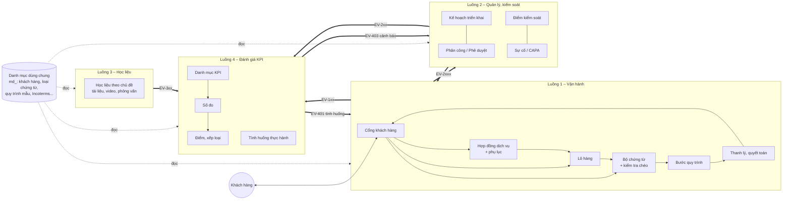

# 01 – Kiến trúc tổng thể: 4 luồng xử lý độc lập

## 1. Mục tiêu hệ thống

Hệ thống phục vụ đồng thời hai mục đích trên **cùng một mô hình nghiệp vụ 3PL**:

1. **Vận hành và quản lý thật**: tiếp nhận hợp đồng dịch vụ logistics, kiểm tra bộ chứng từ của khách hàng, thực hiện và kiểm soát các quy trình nghiệp vụ, đo KPI vận hành.
2. **Đào tạo**: người học thực hành chính các quy trình đó trên dữ liệu tình huống (chế độ `training`), được cung cấp học liệu theo chủ đề và được đánh giá bằng chính các KPI vận hành.

Hai mục đích dùng chung quy trình và bộ KPI. Dữ liệu thật và dữ liệu đào tạo tách biệt bằng trường `mode` (BR-01).

## 2. Bốn luồng xử lý

| Luồng | Mã module | Tiền tố API | Câu hỏi nghiệp vụ trả lời | Đầu vào | Đầu ra |
|---|---|---|---|---|---|
| **1. Vận hành** (gồm **cổng khách hàng** `/api/v2/portal`) | `operations` | `/api/v2/ops` | *Hợp đồng và lô hàng được thực hiện thế nào, chứng từ có hợp lệ không, quyết toán bao nhiêu?* | Hợp đồng dịch vụ, phụ lục; yêu cầu dịch vụ; bộ chứng từ khách hàng (S/C, C/I, P/L, C/O, C/Q, B/L…) – nhập bởi nhân viên hoặc khách hàng gửi qua cổng | Lô hàng đã thực hiện; kết quả kiểm tra chứng từ; nhật ký các bước; bảng quyết toán, biên bản thanh lý |
| **2. Quản lý – kiểm soát** | `control` | `/api/v2/control` | *Hợp đồng được triển khai đúng kế hoạch, đúng quy trình, đúng SLA không?* | Sự kiện từ Luồng 1; KPI từ Luồng 4 | Kế hoạch triển khai, phân công, phê duyệt, điểm kiểm soát, sự cố, CAPA |
| **3. Học liệu** | `learning` | `/api/v2/learning` | *Người dùng cần đọc/xem gì để làm đúng bước này, chủ đề này?* | Học liệu do người hướng dẫn biên soạn | Học liệu theo chủ đề/bước quy trình; lộ trình học; tiến độ học |
| **4. Đánh giá – KPI** | `assessment` | `/api/v2/assessment` | *Kết quả thực hiện nghiệp vụ đạt mức nào, người học đạt điểm bao nhiêu?* | Sự kiện từ Luồng 1, 2, 3 | Số đo KPI; điểm, xếp loại kết quả học tập; cảnh báo KPI |



## 3. Nguyên tắc độc lập giữa các luồng (bắt buộc khi coding)

| Mã | Nguyên tắc | Cách kiểm tra |
|---|---|---|
| **N1** | Mỗi luồng là một module riêng `app/flows/<module>/` có đủ `models`, `schemas`, `services`, `router`, `events`, `tests` | Cấu trúc thư mục (`07` §1) |
| **N2** | **Một luồng – một chủ ghi**: chỉ luồng sở hữu được ghi vào bảng của mình (`ops_*`, `ctl_*`, `lrn_*`, `asm_*`) | Test kiến trúc: không có `INSERT/UPDATE` từ module khác |
| **N3** | **Không khóa ngoại chéo luồng**. Tham chiếu sang luồng khác bằng ID/mã kèm bản chụp (snapshot) dữ liệu cần dùng | Rà soát migration Alembic |
| **N4** | **Không import model/service nội bộ của luồng khác.** Chỉ được dùng (a) sự kiện `EV-xxx`, (b) giao diện đọc công bố `app/flows/<module>/public.py` | Test kiến trúc (import-linter) – `07` §4 |
| **N5** | Sự kiện ghi vào bảng outbox `sys_events` **cùng giao dịch** với thay đổi nghiệp vụ; phát lại được; người nhận xử lý **idempotent** theo `event_id` | Test: phát lại 2 lần một sự kiện → kết quả không đổi |
| **N6** | Lỗi hoặc tắt một luồng không làm hỏng luồng khác. Luồng 1 vẫn vận hành khi Luồng 4 tắt; sự kiện chờ trong outbox | Test: tắt consumer Luồng 4, Luồng 1 vẫn chạy đầy đủ |
| **N7** | Danh mục dùng chung (`md_*`) và hạ tầng (`sys_*`) chỉ chứa dữ liệu ổn định, dùng chung thật sự; không chứa logic nghiệp vụ của luồng | Rà soát thiết kế |
| **N8** | Mỗi luồng có thể kiểm thử độc lập: test của luồng X chỉ cần CSDL của X + `md_`/`sys_` + sự kiện giả lập | Bộ test theo luồng (`07` §4) |

**Lý do chọn kiến trúc "modular monolith" + sự kiện nội bộ** thay cho microservices: quy mô hiện tại (một nhóm phát triển, SQLite/PostgreSQL một CSDL) không cần triển khai tách rời; nguyên tắc N1–N8 bảo đảm có thể tách thành dịch vụ riêng sau này mà không phải thiết kế lại.

## 4. Danh mục dùng chung và hạ tầng (không phải luồng)

| Nhóm | Bảng | Nội dung | Chủ ghi |
|---|---|---|---|
| Người dùng, vai trò | `sys_users`, `sys_user_roles` | Tài khoản, vai trò (`00` §4) | `admin` |
| Khách hàng, đối tác | `md_parties` | Khách hàng (chủ hàng), người bán/người mua nước ngoài, hãng tàu, hãng bay, đại lý, nhà vận tải, kho; `party_type`; mã số thuế. **Đã làm (Giai đoạn 1, 08/11/2026)**: `party_type` ∈ `customer`, `foreign_seller`, `foreign_buyer`, `shipping_line`, `airline`, `agent`, `carrier`, `warehouse`; `name`, `tax_code` (duy nhất; VN 10 số hoặc `0101234567-001`), `country_code` (ISO 3166-1 alpha-2, mặc định `VN`), `address`, `contact_name`, `phone`, `email`, `note`; `status` `active`/`archived` (không xóa cứng); API `/api/v2/md/parties` (đọc: vai trò nội bộ; ghi: `manager`, `admin`). Danh sách trường: **CẦN XÁC NHẬN** | `admin`, `manager` |
| Loại chứng từ | `md_document_types` | Mã (`SC`, `CI`, `PL`, `CO`, `CQ`, `BL`, `AWB`…), tên, trường dữ liệu bắt buộc phải trích xuất | `admin` |
| Quy trình nghiệp vụ mẫu | `md_process_templates`, `md_process_steps` | Quy trình chuẩn **có phiên bản**, các bước, vai trò thực hiện, chứng từ vào/ra, thời gian chuẩn, cờ điểm kiểm soát (chi tiết `02` §4) | `manager` (phê duyệt), `admin` |
| Bộ quy tắc kiểm tra chứng từ (có phiên bản) | `md_rule_sets` | Phạm vi `production` / `training` (theo khóa học hoặc tình huống); trạng thái `draft`/`published`/`retired` (`02` §5.3) | `manager` (`production` – công bố cần phê duyệt cấp 2 của `business_manager`), `instructor` (`training`) |
| Khoản mục thu – chi | `md_cashbook_categories` | Khoản mục phiếu thu/phiếu chi theo hợp đồng (`02` §3.10.1) | `manager` |
| Mẫu văn bản | `md_document_templates` | Mẫu DOCX có phiên bản: hợp đồng, phụ lục, biên bản thanh lý, phiếu thu/chi in (`02` §3.11) | `manager` |
| Ma trận chứng từ bắt buộc | `md_required_documents` | Thuộc một bộ quy tắc; (loại dịch vụ × chiều xuất/nhập × phương thức) → chứng từ bắt buộc/có điều kiện/tùy chọn | Như trên – **thêm, sửa, xóa** được |
| Quy tắc kiểm tra chứng từ | `md_document_rules` | Thuộc một bộ quy tắc; mỗi quy tắc chọn một bộ đánh giá trong thư viện code và khai tham số, điều kiện áp dụng, mức độ (`02` §5.3) | Như trên – **thêm, sửa, xóa** được |
| Danh mục tham chiếu | `md_incoterms`, `md_units`, `md_locations` (cảng, sân bay, ICD, kho), `md_currencies`, `md_countries` | Dữ liệu tham chiếu | `admin` |
| File | `sys_files` | Metadata file (khóa lưu trữ, MIME, dung lượng, SHA-256); nội dung trên kho lưu trữ (`06` §2.6) | Module tạo file |
| Sự kiện | `sys_events`, `sys_event_consumptions` | Outbox và vết xử lý của người nhận | Hạ tầng |
| Nhật ký | `sys_audit_logs` | Ai, khi nào, thao tác gì, giá trị trước/sau | Hạ tầng (tự động) |

## 5. Danh mục sự kiện tích hợp

Định dạng chung (lưu trong `sys_events.payload`, JSON):

```json
{
  "event_id": "uuid",
  "event_code": "EV-132",
  "event_name": "ops.task.completed",
  "schema_version": 1,
  "occurred_at": "2026-11-08T04:00:00Z",
  "mode": "production | training",
  "actor_id": 12,
  "data": { }
}
```

| Mã | Tên | Luồng phát | Luồng nhận | Dữ liệu chính (`data`) |
|---|---|---|---|---|
| EV-101 | `ops.contract.activated` | 1 | 2, 4 | `contract_id`, `contract_no`, `customer_id`, `service_scope[]`, `sla{}`, `valid_from`, `valid_to` |
| EV-102 | `ops.contract.closed` | 1 | 2, 4 | `contract_id`, `closed_reason` (`liquidated` / `terminated`), `settlement_id`, `balance_due`, `currency` |
| EV-103 | `ops.contract.amended` | 1 | 2, 4 | `contract_id`, `amendment_id`, `contract_version`, `changed_groups[]`, `service_scope[]`, `sla{}`, `valid_to` (giá trị sau phụ lục) |
| EV-104 | `ops.contract.liquidation_started` | 1 | 2 | `contract_id`, `reason` (`expired` / `completed` / `terminated`) |
| EV-111 | `ops.shipment.created` | 1 | 2, 4 | `shipment_id`, `contract_id`, `process_code`, `process_version`, `planned_tasks[]` (step_code, planned_start, planned_end, is_checkpoint), `scenario_assignment_id?`, `learner_id?` |
| EV-112 | `ops.shipment.status_changed` | 1 | 2, 4 | `shipment_id`, `from`, `to` |
| EV-113 | `ops.service_request.submitted` | 1 | 2, 4 | `request_id`, `contract_id`, `channel` (`portal` / `staff`), `submitted_at`, `response_due_at` |
| EV-114 | `ops.service_request.decided` | 1 | 2, 4 | `request_id`, `decision` (`accepted` / `rejected`), `decided_at`, `decided_by`, `shipment_id?` |
| EV-115 | `ops.staff_advance.disbursed` | 1 | 2 | `advance_id`, `contract_id`, `shipment_id?`, `staff_id`, `amount`, `currency`, `due_date` |
| EV-116 | `ops.staff_advance.settled` | 1 | 2 | `advance_id`, `settled_at` |
| EV-121 | `ops.document.received` | 1 | 2 | `document_id`, `shipment_id`, `doc_type`, `version_no` |
| EV-122 | `ops.document_check.completed` | 1 | 2, 4 | `check_id`, `shipment_id`, `run_no`, `blocking_count`, `warning_count`, `discrepancies[]` (source `auto`/`manual`, rule_code, doc_types, line_no, field, expected, actual) |
| EV-131 | `ops.task.started` | 1 | 2, 4 | `task_id`, `shipment_id`, `step_code`, `performer_id` |
| EV-132 | `ops.task.completed` | 1 | 2, 4 | `task_id`, `shipment_id`, `step_code`, `performer_id`, `planned_end`, `actual_end`, `sequence_ok`, `evidence_ok` |
| EV-133 | `ops.task.blocked` | 1 | 2 | `task_id`, `shipment_id`, `reason_code`, `note` |
| EV-134 | `ops.approval.requested` | 1 | 2 | `request_id`, `contract_id`, `shipment_id?`, `request_type`, `reference`, `amount?`, `currency?`, `reason`, `requested_by` |
| EV-141 | `ops.customs.cleared` | 1 | 2, 4 | `shipment_id`, `declaration_no`, `channel` (`green/yellow/red`), `submitted_at`, `cleared_at` |
| EV-142 | `ops.shipment.delivered` | 1 | 2, 4 | `shipment_id`, `delivered_at`, `sla_due_at`, `in_full`, `damage_free` |
| EV-201 | `ctl.plan.approved` | 2 | 1, 4 | `plan_id`, `contract_id`, `kpi_targets[]` (kpi_code, target), `milestones[]` |
| EV-202 | `ctl.assignment.changed` | 2 | 1 | `shipment_id`, `task_id?`, `assignee_id` |
| EV-203 | `ctl.approval.decided` | 2 | 1 | `request_id`, `decision` (`approved/rejected`) – quyết định cuối cùng, `decisions[]` (level, approver_id, approver_role, decision, note, decided_at) |
| EV-204 | `ctl.checkpoint.evaluated` | 2 | 1, 4 | `checkpoint_id`, `shipment_id`, `task_id`, `step_code`, `result` (`passed/failed`), `attempt_no`, `performer_id` |
| EV-205 | `ctl.incident.opened` | 2 | 1, 4 | `incident_id`, `contract_id`, `shipment_id`, `incident_type`, `severity`, `attributed_to?` |
| EV-206 | `ctl.incident.closed` | 2 | 1, 4 | `incident_id`, `contract_id`, `shipment_id`, `root_cause_code`, `liability` (`company` / `customer` / `third_party` / `force_majeure`), `compensation_amount?`, `currency?`, `closed_at` |
| EV-207 | `ctl.coordination.directive` | 2 | 1 | `shipment_id`, `task_id?`, `directive_type` (`set_priority` / `remind` / `expedite`), `priority?`, `target_user_id?`, `message`, `issued_by` |
| EV-301 | `lrn.resource.published` | 3 | – (dự phòng) | `resource_id`, `resource_type`, `topic_codes[]`, `step_codes[]` |
| EV-302 | `lrn.enrollment.created` | 3 | 4 | `cohort_id`, `course_id`, `learner_id`, `required_resource_ids[]` |
| EV-303 | `lrn.progress.completed` | 3 | 4 | `learner_id`, `course_id`, `resource_id`, `completed_at` |
| EV-401 | `asm.scenario.assigned` | 4 | 1 | `assignment_id`, `learner_id`, `scenario_code`, `contract_payload`, `shipment_payload`, `document_payloads[]` (kèm `file_id`), `process_code`, `ruleset_code`, `ruleset_version`, `auto_check_visible`, `due_at` – **không** chứa đáp án |
| EV-402 | `asm.result.finalized` | 4 | 2, 3 | `learner_id`, `assessment_id`, `course_id`, `score`, `grade` |
| EV-403 | `asm.kpi.alert` | 4 | 2 | `subject_type`, `subject_id`, `kpi_code`, `value`, `threshold`, `period` |

Quy định:
- Thêm trường mới vào `data` → giữ `schema_version`; xóa/đổi nghĩa trường → tăng `schema_version`, người nhận hỗ trợ song song 2 phiên bản trong 1 kỳ phát hành.
- **Đã làm (Giai đoạn 8, 09/11/2026)**: phát EV-101 (kích hoạt hợp đồng), EV-111, EV-112, EV-142 (lô hàng) – `app/shared/events/` (`contracts.py`: model `data`; `publisher.py`). Tạm **ghi vào `sys_audit_logs`** trong cùng giao dịch với thay đổi: `action = event.<mã>`, `after` = phong bì đầy đủ ở trên; chưa có outbox `sys_events`, bộ phát, người nhận (Luồng 2, 4 chưa làm). EV-111 thêm `shipment_no`, `customer_id` (thêm trường – giữ `schema_version` 1); `process_code`/`process_version` null, `planned_tasks` rỗng (chưa có quy trình mẫu).
- **Đã làm (Giai đoạn 10, 09/11/2026) – outbox**: `publisher.publish` ghi phong bì vào **`sys_events`** trong cùng giao dịch (vẫn ghi thêm dòng `event.<mã>` trong `sys_audit_logs`); sau commit xếp tác vụ `dispatch_events` (hàng rq `events`, chỉ mang id) → worker `XADD` phong bì vào Redis Stream `l3pl:events:control` (Luồng 2) và `l3pl:events:assessment` (Luồng 4) – người nhận đọc bằng consumer group, xử lý idempotent theo `event_id` (N5). Trạng thái gửi theo từng luồng ở `sys_events.deliveries`; luồng đang tắt (ENABLED_FLOWS) → sự kiện chờ `pending` cho luồng đó (N6); lỗi → log, thử lại `JOB_MAX_RETRIES` lần, hết lượt → `failed` + nhật ký `outbox.dispatch_failed`; Redis lỗi lúc xếp → chờ trong outbox, xếp lại khi API/worker khởi động hoặc `python -m app.shared.events.cli dispatch [--failed]`. Sự kiện Giai đoạn 8–9 trong nhật ký được migration `0011` chuyển sang outbox. Thêm sự kiện nội bộ `doc.extracted`, `doc.failed`, `doc.approval_pending`, `doc.approved`, `doc.rejected`, `doc.linked` (job trích xuất chứng từ AI – chỉ id, trạng thái, model; **không** chứa giá trị trích được), luồng nhận 2, 4. `sys_event_consumptions` (vết xử lý phía người nhận): làm cùng Luồng 2, 4.
- **Đã làm (Giai đoạn 11, 09/11/2026) – người nhận**: `app/shared/events/consumer.py` (đăng ký xử lý theo luồng + mã sự kiện; đọc stream bằng consumer group; `sys_event_consumptions` – UNIQUE `consumer` + `event_id`, ghi cùng giao dịch với xử lý → không xử lý trùng; lỗi thử lại, hết lượt `dead`; replay từ `sys_events`). Luồng 2 nhận EV-101, EV-111, EV-112; Luồng 1 (`ops`) nhận EV-202. EV-202 có thêm `previous_assignee_id`, `method`, `reason`. EV-111 thêm `direction`, `transport_mode`, `required_delivery_at`, `service_codes` (thêm trường – giữ `schema_version` 1). Mã luồng nhận trong outbox = mã ENABLED_FLOWS: `ops`, `control`, `assessment`.
- **Đã làm (Giai đoạn 12, 09/11/2026)**: Luồng 2 phát `ctl.task.started`, `ctl.task.completed`, `ctl.task.blocked`, `ctl.task.delayed`, `ctl.alert.raised` (luồng nhận: 4) qua outbox – mã dạng tên, **CẦN XÁC NHẬN** mã EV chính thức. EV-101 không đổi (Luồng 1 phát, Luồng 2 nhận từ Giai đoạn 11).
- **Đã làm (Giai đoạn 13, 09/11/2026)**: Luồng 1 phát EV-131 `ops.task.started`, EV-132 `ops.task.completed`, EV-133 `ops.task.blocked` (+ `ops.task.unblocked` – chưa có mã EV, **CẦN XÁC NHẬN**) khi bước đổi ở Luồng 1 hoặc khi nhận thay đổi từ Luồng 2; thêm trường `ctl_task_id`, `base_revision`, `origin` (giữ `schema_version` 1); `evidence_ok` = null (chưa kiểm chứng từ đầu ra). Luồng 2 phát `ctl.task.synced` (luồng nhận 1 – trạng thái đầy đủ + `revision`) và `ctl.alert.escalated` (luồng nhận 4).
- **Đã làm (Giai đoạn 18, 09/11/2026)**: Luồng 3 phát EV-302 `lrn.enrollment.created` (`cohort_id` = `course_id` = id hợp đồng đào tạo; thêm `contract_id`, `instructor_id`), EV-303 `lrn.progress.completed` (`resource_id` = id buổi học; thêm `completed`, `contract_id`, `attendance`), `lrn.contract.activated`, `lrn.contract.closed`, `lrn.session.scheduled`, `lrn.session.cancelled` (chưa có mã EV – **CẦN XÁC NHẬN**); luồng nhận 4, `mode = training`.
- **Đã làm (Giai đoạn 17, 09/11/2026)**: EV-121 phát cả khi khách hàng gửi chứng từ qua cổng (`actor_id` = tài khoản khách hàng); EV-112 `docs_verified → docs_collecting` khi có chứng từ mới; EV-122 có sai lệch `source = auto` (`rule_code = DOC_REQUIRED_MISSING`).
- **Đã làm (Giai đoạn 16, 09/11/2026)**: Luồng 1 phát **EV-121** (tải chứng từ lô), **EV-122** (ghi kết quả kiểm tra chứng từ – sai lệch `source = manual`, người kiểm = `actor_id`), **EV-141** (điểm kiểm soát thông quan đạt) và `ops.checkpoint.evaluated` (điểm kiểm soát của lô – chưa có mã EV, **CẦN XÁC NHẬN**; luồng nhận 4). `md_locations` thêm vào danh mục dùng chung.
- **Đã làm (Giai đoạn 15, 09/11/2026)**: Luồng 2 phát **EV-201** khi `business_manager` duyệt kế hoạch (thêm `plan_version`, `approved_by`; `kpi_targets[]` có thêm `warning_threshold`, `unit`). Luồng 4 phát **EV-403** (thêm `alert_id`, `subject_label`, `kpi_name`, `unit`, `direction`, `target`, `severity`, `period_start`, `period_end`; `period` = `week`/`month`/`quarter`); Luồng 2 nhận → cảnh báo `kpi_below_target`. Luồng 4 nhận thêm EV-113, EV-114, EV-121 (thêm luồng nhận 4 – KPI-02), EV-122, EV-141, EV-201, EV-204, EV-205, EV-206 – các sự kiện Luồng 1 / Luồng 2 này **chưa có nơi phát**. `ctl.alert.escalated.shipment_id` cho phép null.
- **Đã làm (Giai đoạn 14, 09/11/2026)**: Luồng 4 (`assessment`) nhận EV-101, EV-111, EV-112, EV-142, EV-131, EV-132, EV-133, `ops.task.unblocked`, `ctl.task.*`, `ctl.alert.*` (`05` §11). Thêm luồng nhận 4 cho EV-133, `ops.task.unblocked`, `ctl.task.synced` (sự kiện phát trước đó giữ luồng nhận cũ – `sys_events.consumers` không sửa được); `ctl.task.started|completed|blocked|delayed` thêm trường `revision` (giữ `schema_version` 1) để Luồng 4 khử trùng với `ctl.task.synced` / EV-13x của cùng thay đổi.
- Sự kiện `mode = training` **không** được Luồng 2 dùng để tính cảnh báo vận hành thật (BR-01).

## 6. Giao diện đọc công bố (`public.py`)

Dùng khi một luồng cần **đọc** dữ liệu hiện thời của luồng khác (không ghi). Danh sách tối thiểu:

| Luồng cung cấp | Hàm đọc | Người dùng |
|---|---|---|
| 1 | `get_shipment_summary(shipment_id)`, `list_tasks(shipment_id)`, `get_document_check(check_id)` | 2 (màn hình giám sát), 4 (minh chứng chấm) |
| 1 | `get_amendment_diff(amendment_id)`, `get_settlement_summary(settlement_id)`, `get_charge(charge_id)`, `get_cash_voucher(voucher_id)`, `get_staff_advance(advance_id)`, `get_ruleset_diff(ruleset_id)` | 2 (hộp phê duyệt hợp đồng – tài chính) |
| 1 | `get_contract_financials(contract_id)`, `get_business_summary(period)` | 2 (bảng tổng hợp kinh doanh – CTL-F14) |
| 3 | `find_resources(step_code=…, topic_code=…, audience=…)` | 1 (gợi ý học liệu khi làm một bước), 2 |
| 4 | `get_kpi_values(subject_type, subject_id, period)` | 2 (bảng điều khiển), 1 (giảm trừ SLA theo kỳ khi quyết toán – `02` §3.9.1) |

Giao diện đọc trả DTO (Pydantic) riêng, không trả đối tượng ORM.

## 7. Quy tắc nghiệp vụ xuyên luồng

| Mã | Quy tắc |
|---|---|
| **BR-01** | Mọi bản ghi Luồng 1 có `mode` (`production`/`training`), không đổi sau khi tạo. Truy vấn mặc định của `ops_staff`, `manager` chỉ thấy `production`; `learner` chỉ thấy bản ghi `training` của chính mình; `instructor` thấy `training` của lớp mình phụ trách |
| **BR-02** | Quy trình mẫu được khóa theo phiên bản khi tạo lô hàng (`process_code` + `process_version`); sửa quy trình mẫu không làm thay đổi lô hàng đang thực hiện |
| **BR-03** | Chứng từ đã tiếp nhận không bị xóa; sửa = tải phiên bản mới (`version_no + 1`), phiên bản cũ chuyển `superseded` (yêu cầu lưu vết hồ sơ) |
| **BR-04** | Mọi thao tác ghi được ghi `sys_audit_logs` |
| **BR-05** | KPI chỉ được tính ở Luồng 4. Luồng 2 hiển thị KPI qua `public.py` của Luồng 4, không tự tính lại |
