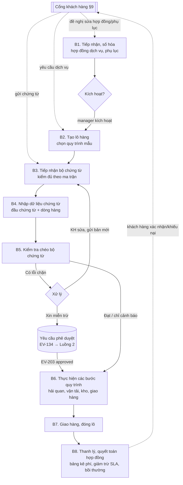

# 02 – Luồng 1: Quản lý vận hành – thực hiện quy trình nghiệp vụ

> Module `app/flows/operations` · API `/api/v2/ops` · Bảng `ops_*` · Mã yêu cầu `OPS-Fxx` · Quy tắc `BR-1xx`, `R-xx`

## 1. Phạm vi

**Đầu vào gốc**: hợp đồng dịch vụ logistics giữa khách hàng và công ty 3PL.
**Căn cứ thực hiện**: bộ chứng từ khách hàng cung cấp cho từng lô hàng – hợp đồng mua bán (S/C), hóa đơn thương mại (C/I), phiếu đóng gói (P/L), giấy chứng nhận xuất xứ (C/O), giấy chứng nhận chất lượng (C/Q), vận đơn (B/L/AWB), giấy phép, chứng thư kiểm dịch, chứng từ bảo hiểm…
**Kênh tiếp nhận**: nhân viên vận hành nhập trực tiếp, hoặc khách hàng tự gửi qua **cổng khách hàng** (§9) – yêu cầu dịch vụ, chứng từ, đề nghị cập nhật/chỉnh sửa hợp đồng, xác nhận quyết toán.
**Đầu ra**: lô hàng được thực hiện đầy đủ theo quy trình mẫu, có kết quả kiểm tra chứng từ, nhật ký từng bước và minh chứng; hợp đồng được **thanh lý, quyết toán** khi kết thúc.

**Không thuộc Luồng 1**: lập kế hoạch, phân công, phê duyệt, điểm kiểm soát, sự cố (Luồng 2); tính KPI (Luồng 4); học liệu (Luồng 3); kế toán tài chính (hệ thống tài khoản, bút toán kép, báo cáo tài chính), phát hành hóa đơn điện tử – hệ thống **không tích hợp** phần mềm kế toán và hóa đơn điện tử; hóa đơn (nếu có) phát hành ngoài hệ thống, trong hệ thống chỉ ghi số hóa đơn tham chiếu; báo giá trước khi ký hợp đồng (**CẦN XÁC NHẬN**).

**Thuộc Luồng 1 về tài chính**: biểu giá, khoản phí (§3.8), quyết toán – thanh lý (§3.9) và **sổ thu – chi theo hợp đồng** theo phương pháp kế toán thống kê kiểu đội sản xuất (§3.10).

## 2. Luồng nghiệp vụ



| Bước | Người thực hiện | Mô tả | Kết quả / sự kiện |
|---|---|---|---|
| B1 | `ops_staff` nhập, `manager` kích hoạt; khách hàng góp ý bản nháp qua cổng | Nhập hợp đồng dịch vụ: khách hàng, phạm vi dịch vụ, hiệu lực, SLA, biểu giá, điều khoản trách nhiệm, phạt vi phạm SLA; đính kèm bản scan. Trong thời gian hiệu lực, thay đổi chỉ thực hiện qua **phụ lục** (§3.7) | `active`; EV-101; EV-103 khi phụ lục có hiệu lực |
| B2 | `ops_staff` (tạo trực tiếp hoặc chấp nhận yêu cầu dịch vụ của khách hàng – §3.6) | Tạo lô hàng thuộc hợp đồng `active`; khai chiều (nhập/xuất/nội địa), phương thức, Incoterms, cảng/điểm đi–đến, dự kiến ETD/ETA, ngày giao yêu cầu; hệ thống đề xuất quy trình mẫu theo (phạm vi dịch vụ × chiều × phương thức), sinh danh sách bước (`ops_tasks`) với thời gian kế hoạch | `docs_collecting`; EV-111 |
| B3 | `ops_staff` hoặc khách hàng (cổng) | Tải lên từng chứng từ; hệ thống so với ma trận chứng từ bắt buộc, hiển thị còn thiếu (khách hàng thấy danh sách còn thiếu trên cổng) | EV-121 |
| B4 | `ops_staff` | Nhập trường đầu chứng từ và dòng hàng theo mẫu cấu trúc của từng loại chứng từ (`md_document_types`) | Dữ liệu sẵn sàng kiểm tra |
| B5 | Hệ thống (do `ops_staff` kích hoạt) | Chạy bộ quy tắc đang công bố của phạm vi tương ứng (§5.3; khởi tạo gồm R-01…R-14); ghi lần chạy, phiên bản bộ quy tắc và danh sách sai lệch | EV-122 |
| B6 | `ops_staff` được phân công | Thực hiện từng bước theo thứ tự; bước có cờ điểm kiểm soát chờ kết quả Luồng 2 (EV-204) | EV-131, EV-132, EV-133, EV-141 |
| B7 | `ops_staff` | Ghi nhận giao hàng (thời điểm, đủ hàng, nguyên vẹn, biên bản giao nhận), ghi các khoản phí của lô (§3.8), hoàn tất bước cuối | EV-142; `closed` |
| B8 | `ops_staff` lập, `manager` duyệt (qua Luồng 2), khách hàng xác nhận trên cổng | Thanh lý, quyết toán hợp đồng khi hết hiệu lực, hoàn thành hoặc chấm dứt trước hạn: lập bảng quyết toán, đối soát với khách hàng, lập và ký biên bản thanh lý (§3.9) | EV-104; EV-102 |

## 3. Mô hình dữ liệu

Khóa ngoại chỉ trong nội bộ Luồng 1 và tới `md_*`/`sys_*` (N3). Trường chung `id`, `created_at`, `created_by`, `updated_at`, `updated_by`, `row_version` theo `06` §2.4 – không nhắc lại.

### 3.1. `ops_service_contracts` – Hợp đồng dịch vụ

| Trường | Kiểu | B/T | Ghi chú |
|---|---|---|---|
| `contract_no` | VARCHAR(30), duy nhất | Hệ thống | `HD-yyyy-nnnn`; `TR-HD-…` với `training` |
| `customer_contract_ref` | VARCHAR(100) | T | Số hợp đồng theo cách đánh số của khách hàng |
| `mode` | ENUM `production`, `training` | B | BR-01 |
| `learner_id` | → `sys_users` | B khi `training` | |
| `scenario_assignment_id` | BIGINT (tham chiếu Luồng 4, không FK) | T | Có khi được tạo từ EV-401 |
| `customer_id` | → `md_parties` | B | Kèm snapshot `customer_name`, `customer_tax_code` |
| `signed_date`, `valid_from`, `valid_to` | DATE | B | `valid_from ≤ valid_to` |
| `service_scopes` | bảng con `ops_contract_scopes` (`service_code`, `params` JSON) | B (≥ 1) | `CUSTOMS_CLEARANCE`, `SEA_FREIGHT`, `AIR_FREIGHT`, `ROAD_TRANSPORT`, `WAREHOUSING`, `DISTRIBUTION`, `CARGO_INSURANCE_ARRANGEMENT`, `LICENSE_APPLICATION` (danh mục mở rộng được) |
| `sla_terms` | bảng con `ops_contract_sla` (`sla_code`, `description`, `target_value`, `unit`, `kpi_code?`, `measure_level` (`per_shipment` / `per_period`), `penalty_rule` JSON) | T | Ví dụ: thông quan ≤ 24 giờ làm việc; giao đúng hạn ≥ 95%/tháng. `kpi_code` liên kết danh mục KPI Luồng 4 (`05` §3). `penalty_rule`: cách giảm trừ khi vi phạm (vd. x% phí dịch vụ của lô vi phạm; y% phí dịch vụ của kỳ khi KPI kỳ dưới mục tiêu; trần z% giá trị hợp đồng) – dùng khi quyết toán (§3.9) |
| `rates` | bảng con `ops_contract_rates` (§3.8) | B khi kích hoạt | Biểu giá dịch vụ |
| `liability_terms` | TEXT | T | Giới hạn trách nhiệm, bồi thường |
| `payment_terms` | TEXT + `advance_required`, `payment_due_days` | T | Điều kiện tạm ứng, thời hạn thanh toán |
| `contract_version` | INT | Hệ thống | Bắt đầu 1; tăng khi phụ lục có hiệu lực; bản chụp mỗi phiên bản lưu `ops_contract_versions` (`contract_version`, `snapshot` JSON, `amendment_id`, `effective_from`) |
| `portal_enabled` | BOOLEAN | B (mặc định `true` với `production`) | Cho phép khách hàng thao tác trên cổng (§9) |
| `contract_file_id`, `signed_document_id` | → `sys_files`, → `ops_signed_documents` | B khi kích hoạt | Bản scan có chữ ký, đã xác nhận theo §3.11 |
| `status` | ENUM | B | §6.1 |

**Đã làm (Giai đoạn 3, 08/11/2026)** – `app/flows/operations/`: `contract_no` (`HD-yyyy-nnnn`, bộ đếm `sys_doc_sequences` theo năm giờ Việt Nam, không trùng/nhảy số khi tạo song song), `customer_contract_ref`, `mode` (cột có sẵn; API chỉ nhận `production` – `training` làm cùng lớp/người học), `customer_id` + bản chụp `customer_name`, `customer_tax_code` (khách hàng phải là `customer` đang hoạt động), `signed_date` (bắt buộc khi kích hoạt), `valid_from ≤ valid_to`, `liability_terms`, `payment_terms`, `advance_required`, `payment_due_days`, `portal_enabled` (mặc định `true`), `status`. **Giai đoạn 4**: `ops_contract_scopes`, `ops_contract_sla`, `ops_contract_rates` theo (`contract_id`, `contract_version`) – sửa khi nháp qua PATCH (mảng thay toàn bộ); `contract_version` + `ops_contract_versions` (bản chụp điều khoản + bảng con; phiên bản 1 khi kích hoạt); `contract_file_id` thay bằng `ops_contract_attachments` (`kind` = `signed_contract`/`amendment`/`liquidation_minutes`/`other`, `customer_visible`; nội dung `sys_files`). Chưa làm: `signed_document_id` (§3.11), `learner_id`, `scenario_assignment_id`.

### 3.2. `ops_shipments` – Lô hàng

| Trường | Kiểu | B/T | Ghi chú |
|---|---|---|---|
| `shipment_no` | VARCHAR(30), duy nhất | Hệ thống | `LH-yyyy-nnnnnn` / `TR-LH-…` |
| `contract_id` | → `ops_service_contracts` | B | Hợp đồng phải `active`; `mode` kế thừa từ hợp đồng |
| `direction` | ENUM `import`, `export`, `domestic` | B | |
| `transport_mode` | ENUM `sea_fcl`, `sea_lcl`, `air`, `road`, `rail`, `multimodal` | B | |
| `incoterm` | → `md_incoterms` (bản 2020) | B khi `import`/`export` | Kèm `incoterm_place` |
| `shipper_id`, `consignee_id`, `notify_party_id` | → `md_parties` | B / B / T | Kèm snapshot tên |
| `origin_location_id`, `destination_location_id` | → `md_locations` | B | Cảng/sân bay/ICD/kho |
| `cargo_summary` | JSON | T | Tổng số kiện, trọng lượng cả bì (kg), thể tích (m³), danh sách container (số, loại 20GP/40HC…, seal) |
| `etd`, `eta`, `required_delivery_at` | TIMESTAMPTZ | T / T / B | `required_delivery_at` làm hạn SLA |
| `claims_preferential_tariff` | BOOLEAN | B (mặc định `false`) | Lô xin hưởng ưu đãi thuế theo C/O – dùng trong điều kiện ma trận/quy tắc |
| `service_request_id` | → `ops_service_requests` | T | Có khi lô được tạo từ yêu cầu dịch vụ của khách hàng (§3.6) |
| `process_code`, `process_version` | VARCHAR | B | Khóa khi tạo (BR-02) |
| `assignee_id` | BIGINT (snapshot từ EV-202) | T | Người phụ trách lô |
| `priority` | ENUM `normal`, `high`, `urgent` (snapshot từ EV-207) | B (mặc định `normal`) | Mức ưu tiên do người giám sát, điều phối đặt; danh sách việc sắp xếp theo ưu tiên rồi hạn |
| `status` | ENUM | B | §6.2 |

**Đã làm (Giai đoạn 8, 09/11/2026)** – migration `0009`, `app/flows/operations/shipment_*.py`: `ops_shipments` với các trường trên trừ `process_code`/`process_version` (chưa có quy trình mẫu), `service_request_id` (chưa có yêu cầu dịch vụ); `incoterm` kiểm theo danh sách Incoterms 2020 cố định (chưa có `md_incoterms`); điểm đi/đến tạm là văn bản `origin_location`/`destination_location` (Giai đoạn 17: thay bằng `origin_location_id`, `destination_location_id` → `md_locations` đang hoạt động, bắt buộc với lô mới – trigger khi INSERT, hai điểm khác nhau; cột văn bản thành bản chụp "mã – tên"; lô cũ giữ NULL + văn bản cũ); thêm `contract_version` (phiên bản hợp đồng lúc tạo – §3.7), `customer_id` (= khách hàng của hợp đồng), `status_reason` (lý do hủy), `delivered_at`/`closed_at`/`cancelled_at`. Bảng thêm: `ops_shipment_status_history` (lịch sử trạng thái – theo dõi tiến độ), `ops_delivery_records` (chưa có `pod_file_id`). Lô `closed`/`cancelled` chỉ đọc, không xóa lô, lịch sử và biên bản giao chỉ ghi thêm – service + trigger CSDL. Số lô `LH-yyyy-nnnnnn` từ `sys_doc_sequences` (tạo song song không trùng số).

### 3.3. `ops_documents` – Chứng từ

| Trường | Kiểu | B/T | Ghi chú |
|---|---|---|---|
| `shipment_id` | → `ops_shipments` | B | |
| `doc_type` | → `md_document_types.code` | B | `SC`, `CI`, `PL`, `CO`, `CQ`, `BL`, `AWB`, `AN` (thông báo hàng đến), `DO`, `INS`, `PHYTO`, `LICENSE`, `CUSTOMS_DECL`, `POD`, `OTHER` |
| `doc_no`, `doc_date` | VARCHAR(100), DATE | B | Duy nhất theo (`shipment_id`, `doc_type`, `doc_no`, `version_no`) |
| `issuer_name` | VARCHAR(255) | T | Người lập/cơ quan cấp |
| `version_no` | INT | Hệ thống | Bắt đầu 1; BR-03 |
| `is_original` | BOOLEAN | T | Bản gốc/bản sao |
| `received_at`, `received_from` | TIMESTAMPTZ, VARCHAR | B | |
| `header_data` | JSON | B | Trường đầu chứng từ theo cấu trúc của loại (vd. C/I: seller, buyer, sc_no, sc_date, incoterm, incoterm_place, currency, total_amount; C/O: form, co_no, issue_date, exporter, importer, ci_no, ci_date, origin_country) – kiểm tra theo JSON Schema trong `md_document_types.schema` |
| `file_id` | → `sys_files` | B | |
| `status` | ENUM | B | §6.3 |

`ops_document_lines` – dòng hàng: `document_id`, `line_no`, `description`, `hs_code` (VARCHAR(10), chỉ số), `quantity` NUMERIC(18,3), `unit_code`, `net_weight_kg`, `gross_weight_kg`, `packages`, `package_type`, `unit_price` NUMERIC(18,4), `amount` NUMERIC(18,2), `origin_country`, `origin_criterion` (C/O), `marks_numbers`.

**Đã làm (Giai đoạn 16, 09/11/2026)** – `app/flows/operations/document_*.py`, migration `0017`: `ops_documents` (`doc_type` – danh mục rút gọn `bill_of_lading`, `air_waybill`, `commercial_invoice`, `packing_list`, `certificate_of_origin`, `customs_declaration`, `delivery_order`, `sales_contract`, `other` – **CẦN XÁC NHẬN**; `version_no`; `file_id` → `sys_files` mục đích `shipment_document` – pdf, jpg, png, docx, xlsx ≤ 20 MB; `status` `current` / `superseded`, không xóa – BR-03). `POST /api/v2/ops/shipments/{id}/documents` (multipart, `ops_staff` phụ trách lô) → EV-121. Chưa có: trích dữ liệu đầu chứng từ, dòng hàng.

**Đã làm (Giai đoạn 17, 09/11/2026)**: khách hàng gửi chứng từ qua cổng `POST /api/v2/portal/shipments/{id}/documents` (lô thấy được trên cổng – BR-111, chưa đóng / hủy; file nhận dạng theo nội dung; `ops_documents.channel = portal`; EV-121; `GET …/documents` – không có ghi chú, người tải, file). Chứng từ mới (nhân viên hoặc khách hàng) khi lô đang `docs_verified` → lô quay về `docs_collecting` (lịch sử, nhật ký `shipment.reopen_documents`, EV-112) và có lần kiểm tra mới đang chờ – phải kiểm tra lại mới `docs_verified` lại; lô đã `in_execution` trở đi giữ trạng thái (chỉ tạo lần kiểm tra mới – **CẦN XÁC NHẬN**). Quy tắc tự động cơ bản `ops_document_requirements` (loại chứng từ bắt buộc theo `transport_mode` / `direction`, NULL = mọi giá trị; seed: B/L cho `sea_fcl`/`sea_lcl`, AWB cho `air`, hóa đơn + P/L cho nhập / xuất khẩu, lệnh giao hàng cho nội địa – **CẦN XÁC NHẬN**; `admin`, `manager` thêm / bật / tắt qua `/api/v2/ops/document-requirements`): khi ghi kết quả, loại bắt buộc chưa có → dòng `missing` `source = auto` (kèm `rule_id`), EV-122 `rule_code = DOC_REQUIRED_MISSING`; lần đang chờ hiển thị trước `auto_missing`.

### 3.4. Kiểm tra chứng từ

`ops_document_checks`: `shipment_id`, `run_no`, `ruleset_code`, `ruleset_version`, `document_versions` (JSON: doc_id → version_no đã dùng), `result` (`passed`, `passed_with_warnings`, `failed`), `blocking_count`, `warning_count`, `run_by`, `run_at`.

`ops_discrepancies`: `check_id`, `source` (`auto` – do bộ quy tắc sinh / `manual` – do người dùng ghi nhận), `rule_code`, `severity` (`blocking`/`warning`), `doc_types[]`, `line_no?`, `field`, `expected`, `actual`, `message`, `resolution` (`open`, `customer_corrected`, `waived`, `false_positive`), `approval_request_id?`, `resolved_by`, `resolved_at`.

### 3.5. Thực hiện quy trình

`ops_tasks`: `shipment_id`, `step_code`, `seq`, `name` (snapshot), `responsible_role`, `is_checkpoint`, `planned_start`, `planned_end`, `actual_start`, `actual_end`, `performer_id`, `status` (§6.4), `checkpoint_result` (snapshot từ EV-204: `pending`/`passed`/`failed`), `evidence` (JSON: danh sách `document_id`/`file_id`, ghi chú), `block_reason_code`, `skip_reason`, `skip_approval_request_id`.

`ops_customs_declarations`: `shipment_id`, `declaration_no`, `declaration_type_code`, `customs_office_code`, `channel` (`green`/`yellow`/`red`), `submitted_at`, `cleared_at`, `file_id`.

`ops_delivery_records`: `shipment_id`, `delivered_at`, `receiver_name`, `in_full` (BOOLEAN), `damage_free` (BOOLEAN), `remarks`, `pod_file_id`.

`ops_approval_requests`: `contract_id`, `shipment_id?`, `request_type` (`DISCREPANCY_WAIVER`, `SKIP_STEP`, `DEADLINE_EXTENSION`, `OUT_OF_SEQUENCE`, `EXTRA_CHARGE`, `CONTRACT_AMENDMENT`, `CONTRACT_TERMINATION`, `SETTLEMENT`, `PAYMENT_VOUCHER`, `STAFF_ADVANCE`, `RULESET_PUBLISH`), `reference` (JSON: id sai lệch/bước/khoản phí/phụ lục/bảng quyết toán/phiếu chi/tạm ứng/bộ quy tắc), `amount?`, `currency?`, `reason`, `status` (`pending`, `approved`, `rejected` – cập nhật từ EV-203), `decided_by`, `decided_at`, `decision_note`.

### 3.6. `ops_service_requests` – Yêu cầu dịch vụ của khách hàng

| Trường | Kiểu | B/T | Ghi chú |
|---|---|---|---|
| `request_no` | VARCHAR(30), duy nhất | Hệ thống | `YC-yyyy-nnnnn` |
| `contract_id` | → `ops_service_contracts` | B | Hợp đồng `active`, `portal_enabled` |
| `submitted_by` | → `sys_users` (vai trò `customer`) hoặc `ops_staff` nhập thay | B | |
| `service_codes[]` | Thuộc phạm vi dịch vụ của hợp đồng | B | Ngoài phạm vi → `422` kèm gợi ý đề nghị phụ lục |
| `direction`, `transport_mode`, `incoterm`, `incoterm_place` | | B | |
| `origin`, `destination` | → `md_locations` hoặc địa chỉ tự do | B | |
| `cargo_description`, `hs_code_hint`, `packages`, `gross_weight_kg`, `volume_cbm`, `containers` | | B (mô tả, khối lượng) | |
| `special_handling[]` | `dangerous_goods`, `temperature_controlled`, `oversize`, `high_value`, `fragile` | T | Hàng nguy hiểm: bắt buộc đính kèm MSDS/SDS |
| `cargo_ready_at`, `required_delivery_at` | TIMESTAMPTZ | B | |
| `attachments` | `ops_request_attachments` (`doc_type`, `file_id`) | T | Chuyển thành `ops_documents` của lô khi chấp nhận |
| `response_due_at` | TIMESTAMPTZ | Hệ thống | `submitted_at` + thời hạn phản hồi theo SLA hợp đồng (mặc định 4 giờ làm việc – **CẦN XÁC NHẬN**) |
| `status` | `submitted` → `under_review` → `need_info` ↔ `under_review` → `accepted` / `rejected`; `withdrawn` (khách hàng rút trước khi được chấp nhận) | B | Chấp nhận → hệ thống tạo lô hàng (B2), ghi `shipment_id` |
| `decision_note`, `decided_by`, `decided_at` | | | Bắt buộc khi `rejected`/`need_info` |

### 3.7. `ops_contract_amendments` – Cập nhật, chỉnh sửa hợp đồng và phụ lục

| Trường | Ghi chú |
|---|---|
| `amendment_no` | `PL-01`, `PL-02`… theo từng hợp đồng |
| `contract_id`, `base_contract_version` | Phiên bản hợp đồng làm căn cứ |
| `kind` | `draft_revision` – góp ý/đề nghị sửa **bản nháp** trước khi ký; `amendment` – **phụ lục** sửa đổi, bổ sung hợp đồng đang hiệu lực |
| `initiated_by_party` | `customer` (qua cổng) / `company` |
| `changes` | JSON theo từng nhóm: `service_scopes` (thêm/bớt), `sla_terms`, `rates`, `valid_to` (gia hạn), `liability_terms`, `payment_terms`, `other_terms` (văn bản); mỗi thay đổi gồm giá trị cũ – giá trị đề nghị |
| `reason`, `attachments[]` | |
| `negotiation_log` | `ops_amendment_comments`: trao đổi hai bên, phương án đề nghị lại (counter-proposal) |
| `effective_from` | Ngày phụ lục có hiệu lực |
| `signed_document_id` | → `ops_signed_documents` (§3.11) |
| `status` | `proposed` → `under_review` → `negotiating` ↔ `under_review` → `agreed` → `approved` (phê duyệt `CONTRACT_AMENDMENT` – Luồng 2) → `awaiting_signature` (đã sinh văn bản, chờ ký tay và scan) → `effective` (bản scan `confirmed`, BR-116); `rejected`, `withdrawn` |

Khi phụ lục `effective`: áp các thay đổi vào hợp đồng, `contract_version + 1`, lưu bản chụp, phát EV-103. Lô hàng đã tạo giữ điều kiện của phiên bản hợp đồng tại thời điểm tạo, trừ khi phụ lục quy định áp dụng hồi tố (`apply_to_open_shipments = true`).

**Đã làm (Giai đoạn 19, 09/11/2026)** – bản rút gọn: `ops_contract_amendments` (`PL-01`…, `base_contract_version`, `changes` – phạm vi, SLA, biểu giá, `valid_to`, điều khoản; `effective_from`, lý do, bản scan tùy chọn). `ops_staff` / `manager` lập (hợp đồng `active` / `suspended`; áp thử ngay khi lập để báo lỗi quy tắc) → `pending_approval` → duyệt 1 (`manager` / `business_manager`) → `pending_second_approval` → duyệt 2 (**người khác người lập và người duyệt 1** – như duyệt 2 người của Giai đoạn 10; CHECK CSDL) → `effective`: `contract_version + 1`, bản chụp mới, phiên bản cũ giữ nguyên, EV-103; hợp đồng đã đổi phiên bản kể từ khi lập → 409. Từ chối (lý do), người lập rút. `POST …/versions` (áp trực tiếp – Giai đoạn 4) **đã bỏ**. Chưa có: khách hàng đề nghị qua cổng, đàm phán, sinh văn bản, ký và xác nhận bản scan (BR-116), `apply_to_open_shipments`.

### 3.8. Biểu giá và các khoản phí

`ops_contract_rates`: `contract_id`, `contract_version`, `rate_code`, `service_code`, `charge_name`, `basis` (`per_shipment`, `per_container_20`, `per_container_40`, `per_kg`, `per_cbm`, `per_declaration`, `per_pallet_day`, `per_trip`, `lump_sum`), `unit_price` NUMERIC(18,2), `currency`, `min_charge`, `tax_rate` (thuế suất áp cho khoản phí – do người quản lý khai theo hợp đồng; hệ thống không tự xác định thuế suất), `valid_from`, `valid_to`.

`ops_shipment_charges`:

| Trường | Ghi chú |
|---|---|
| `shipment_id`, `contract_id` | |
| `charge_type` | `service` – phí dịch vụ theo biểu giá; `disbursement` – chi hộ (phí cảng, phí hãng tàu, thuế nộp hộ…); `extra` – phí phát sinh ngoài biểu giá; `sla_deduction` – giảm trừ do vi phạm SLA; `compensation` – bồi thường tổn thất |
| `rate_code?`, `description`, `quantity`, `unit_price`, `amount`, `currency`, `tax_rate` | `service`: hệ thống tính từ biểu giá × số lượng (số container, kg, tờ khai…) |
| `supporting_file_id` | **Bắt buộc** với `disbursement` (hóa đơn, biên lai của bên thứ ba) và `extra` |
| `approval_request_id` | **Bắt buộc** với `extra` (phê duyệt `EXTRA_CHARGE`) |
| `source_ref` | `compensation`: id sự cố từ EV-206; `sla_deduction`: mã SLA, lô hoặc kỳ vi phạm |
| `customer_visible` | Mặc định `true` với mọi khoản phí đã `confirmed` |
| `status` | `draft` → `confirmed` → (`disputed` ↔ `confirmed`) → `settled` |

Khoản tạm ứng, thanh toán nhận từ khách hàng và khoản hoàn trả khách hàng **không có bảng riêng**: là phiếu thu/phiếu chi trong sổ thu – chi theo hợp đồng (§3.10, khoản mục T01, T02, T03, C07).

### 3.9. Thanh lý – quyết toán hợp đồng

`ops_contract_settlements`: `settlement_no`, `contract_id`, `settlement_type` (`periodic_statement` – bảng kê đối soát định kỳ / `final` – quyết toán thanh lý hợp đồng), `period_from`, `period_to`, `currency` (đồng tiền quyết toán theo hợp đồng; khoản phát sinh bằng đồng tiền khác quy đổi theo tỷ giá ghi sổ của từng phiếu – §3.10), các tổng §3.9.1, `status` (§6.5), `approval_request_id`, `customer_confirmed_by`, `customer_confirmed_at`, `liquidation_minutes_file_id` (bản hệ thống sinh), `signed_minutes_file_id` (bản đã ký hai bên).

`ops_settlement_lines`: `settlement_id`, `shipment_id?`, `charge_id`, `charge_type`, `description`, `amount`, `tax_amount`.
`ops_settlement_disputes`: `settlement_id`, `line_id?`, `raised_by` (khách hàng), `content`, `response`, `resolution` (`accepted_adjusted` / `rejected_with_explanation`), `resolved_at`.

#### 3.9.1. Công thức quyết toán

| Ký hiệu | Khoản | Nguồn |
|---|---|---|
| A | Phí dịch vụ (`service`) + phí phát sinh đã duyệt (`extra`) | `ops_shipment_charges` các lô trong kỳ/hợp đồng |
| T | Thuế tính trên A theo `tax_rate` từng dòng | Cấu hình biểu giá |
| C | Chi hộ (`disbursement`) theo chứng từ gốc | `ops_shipment_charges` |
| D | Giảm trừ vi phạm SLA | `penalty_rule` của `ops_contract_sla`: vi phạm theo lô – dữ liệu giao hàng của Luồng 1; vi phạm theo kỳ – giá trị KPI hợp đồng đọc qua `assessment.public.get_kpi_values` (BR-05) |
| E | Bồi thường tổn thất do công ty chịu trách nhiệm | Sự cố đã đóng có `liability = company` (EV-206) |
| F | Đã thu của khách hàng trừ đã hoàn trả | Phiếu thu T01, T02, T03 trừ phiếu chi C07 đã ghi sổ của hợp đồng (§3.10) |
| **S** | **Số còn phải thanh toán = A + T + C − D − E − F** | S > 0: khách hàng thanh toán; S < 0: công ty hoàn trả |

Mặc định: chi hộ (C) quyết toán đúng số tiền trên chứng từ gốc, không tính thêm thuế và không cộng lãi (BR-113); giảm trừ (D) và bồi thường (E) trừ thẳng vào số phải thanh toán, không điều chỉnh T. Người quản lý đổi được cách tính theo từng `charge_type` nếu điều khoản hợp đồng quy định khác.

Khi Luồng 4 tắt hoặc chưa có số đo KPI của kỳ (N6), khoản D theo kỳ được nhập tay kèm căn cứ và đánh dấu `manual_override`; bảng quyết toán hiển thị rõ dòng nhập tay để phê duyệt.

#### 3.9.2. Điều kiện và trình tự thanh lý

1. Khởi động thanh lý (`:start-liquidation`) khi hợp đồng `expired`, đã hoàn thành phạm vi, hoặc chấm dứt trước hạn (phê duyệt `CONTRACT_TERMINATION`). Hợp đồng chuyển `liquidating`; không nhận yêu cầu dịch vụ, không tạo lô mới; phát EV-104.
2. **BR-110** – điều kiện lập bảng quyết toán `final`: mọi lô `closed`/`cancelled`; không còn khoản phí `draft`; không còn phụ lục đang xử lý; không còn sự cố mở có thể phát sinh bồi thường (theo bản chụp từ EV-205/EV-206).
3. `ops_staff` lập bảng quyết toán → phê duyệt nội bộ `SETTLEMENT` (Luồng 2) → gửi khách hàng trên cổng.
4. Khách hàng xác nhận hoặc khiếu nại từng dòng; khiếu nại được xử lý, lập lại bảng (phiên bản mới) và gửi lại.
5. Khách hàng xác nhận → hệ thống sinh **biên bản thanh lý** từ mẫu (thông tin hợp đồng, phụ lục, giá trị thực hiện, giảm trừ, bồi thường, đã thanh toán, số còn phải thanh toán, cam kết hai bên); hai bên ký tay, tải bản scan và xác nhận theo §3.11.
6. Bản scan biên bản `confirmed` → bảng quyết toán `completed`, mọi khoản phí `settled`, hợp đồng `closed`, phát EV-102. Số S được tất toán bằng phiếu thu (S > 0) hoặc phiếu chi C07 (S < 0) trong sổ thu – chi (§3.10, BR-112).

**Đã làm (Giai đoạn 19, 09/11/2026)** – bản rút gọn:
- **Chấm dứt trước hạn** `ops_contract_terminations`: `manager` đề xuất (lý do ≥ 10 ký tự, ngày chấm dứt từ hôm nay tới trước `valid_to`; một đề xuất chờ / hợp đồng) → `business_manager` (khác người đề xuất) duyệt / từ chối. Duyệt: lô chưa bắt đầu thực hiện (`draft`, `docs_collecting`, `docs_verified`) tự hủy (lý do "Chấm dứt hợp đồng …", lịch sử, EV-112); lô `in_execution` / `delivered` ghi vào `open_shipment_ids` – phải hoàn tất / hủy trước khi quyết toán; hợp đồng → `liquidating`, EV-104 (`reason = terminated`). `:start-liquidation` với hợp đồng còn hạn → 409.
- **Quyết toán** `ops_contract_settlements` (`final`, `QT-yyyy-nnnn`, một bảng / hợp đồng): `manager` lập khi BR-110 đủ (hợp đồng `expired` / `liquidating`; mọi lô `closed` / `cancelled`; không còn phụ lục / đề xuất chấm dứt đang xử lý). Tổng hợp **hóa đơn thương mại** của hợp đồng (Giai đoạn 10 – chưa có khoản phí `ops_shipment_charges`) theo đồng tiền quyết toán, đồng tiền khác liệt kê riêng (không quy đổi); KPI + mục tiêu + SLA qua `assessment.public.get_kpi_values` (BR-05; Luồng 4 tắt → null); giảm trừ SLA (cần căn cứ), bồi thường, đã thanh toán nhập tay; `balance_due` = hóa đơn − giảm trừ − bồi thường − đã thanh toán (CHECK CSDL). Kỳ: từ `valid_from` tới ngày chấm dứt / `valid_to` (không quá hôm nay). `:submit` (tính lại) → `business_manager` (khác người lập) `:approve` → sự kiện `ops.settlement.approved` (Luồng 4) / `:reject` (lý do) → sửa, gửi lại. `:close` hợp đồng cần quyết toán đã duyệt. Chưa có: khách hàng xác nhận / khiếu nại, sinh biên bản thanh lý, sổ thu – chi, công thức A + T + C − D − E − F đầy đủ, D tự tính theo `penalty_rule`.

### 3.10. Sổ thu – chi theo hợp đồng (kế toán thống kê)

**Phương pháp**: theo dõi thu – chi **thực tế** của từng hợp đồng theo kiểu hạch toán thống kê của đội sản xuất – mỗi hợp đồng là một đối tượng tập hợp thu – chi; ghi chép **đơn** theo phiếu thu/phiếu chi nội bộ có chứng từ gốc, phân theo khoản mục; xác định kết quả (lãi gộp) của từng hợp đồng, từng lô. Không dùng hệ thống tài khoản kế toán, bút toán kép, khấu hao; không phát hành hóa đơn.

#### 3.10.1. Khoản mục thu – chi (`md_cashbook_categories`, cấu hình được)

| Mã | Khoản mục | Chiều | Tính vào kết quả hợp đồng | Ghi chú |
|---|---|---|---|---|
| T01 | Thu tiền dịch vụ | Thu | Doanh thu (thực thu) | Đối ứng khoản phí `service`, `extra` |
| T02 | Thu hoàn chi hộ | Thu | Không (thu hồi chi hộ) | Đối ứng C01 |
| T03 | Thu tạm ứng của khách hàng | Thu | Không (trừ khi quyết toán) | |
| T04 | Thu khác (bồi thường từ bên thứ ba, thanh lý vật tư…) | Thu | Thu nhập khác | |
| C01 | Chi hộ khách hàng (phí cảng, hãng tàu, thuế và lệ phí nộp hộ…) | Chi | Không (theo dõi riêng, phải thu hồi) | BR-113 |
| C02 | Chi thuê vận tải ngoài | Chi | Chi phí trực tiếp | |
| C03 | Chi nâng hạ, lưu kho bãi, lưu container | Chi | Chi phí trực tiếp | |
| C04 | Chi nhân công trực tiếp, bồi dưỡng theo lô | Chi | Chi phí trực tiếp | |
| C05 | Chi phí trực tiếp khác (chuyển phát, in ấn, phí ngân hàng…) | Chi | Chi phí trực tiếp | |
| C06 | Chi bồi thường cho khách hàng | Chi | Chi phí trực tiếp | Đối ứng khoản `compensation` |
| C07 | Chi hoàn trả khách hàng | Chi | Không | Khi S < 0 |
| C08 | Chi tạm ứng cho nhân viên | Chi | Không (theo dõi công nợ tạm ứng) | §3.10.3 |

Người quản lý được thêm khoản mục con (ví dụ tách C03 thành nâng hạ / lưu bãi), không được xóa khoản mục đã có phiếu.

#### 3.10.2. Phiếu thu, phiếu chi (`ops_cash_vouchers`)

| Trường | Ghi chú |
|---|---|
| `voucher_no` | `PT-yyyy-nnnnn` (phiếu thu), `PC-yyyy-nnnnn` (phiếu chi); `TR-` với `training` |
| `voucher_type` | `receipt` / `payment` |
| `contract_id` | **Bắt buộc** – mọi phiếu thuộc một hợp đồng |
| `shipment_id` | Bắt buộc với C01–C06 phát sinh cho lô cụ thể |
| `category_code` | Khoản mục §3.10.1 |
| `counterparty_type`, `counterparty_id`, `counterparty_name` | Khách hàng / nhà cung cấp (`md_parties`) / nhân viên (`sys_users`) |
| `description`, `voucher_date` | |
| `amount`, `currency`, `exchange_rate`, `amount_base` | Tỷ giá ghi sổ nhập theo phiếu; `amount_base` = số tiền quy đổi theo đồng tiền hạch toán (mặc định VND) |
| `payment_method` | `cash` / `bank_transfer` / `offset` (bù trừ với tạm ứng) |
| `supporting_file_ids[]` | **Bắt buộc**: hóa đơn/biên lai bên thứ ba, ủy nhiệm chi, giấy báo có… (bản scan) |
| `external_invoice_no` | Số hóa đơn phát hành ngoài hệ thống (nếu có) |
| `charge_ids[]`, `advance_id?`, `settlement_id?` | Liên kết khoản phí, tạm ứng, bảng quyết toán |
| `status` | `draft` → `submitted` → `approved` (phê duyệt `PAYMENT_VOUCHER` cho phiếu chi – §3.10.4) → `recorded` (ghi sổ); `void` |
| `prepared_by`, `approved_by`, `recorded_by`, `recorded_at` | |

#### 3.10.3. Tạm ứng – hoàn ứng của nhân viên (`ops_staff_advances`)

Đặc thù giao nhận: nhân viên hiện trường nhận tạm ứng để nộp phí cảng, lệ phí, cược container…, sau đó hoàn ứng bằng chứng từ.

| Bước | Nội dung | Ghi sổ |
|---|---|---|
| Đề nghị tạm ứng | `staff_id`, `contract_id`, `shipment_id?`, mục đích, số tiền, `due_date` (hạn hoàn ứng, mặc định 7 ngày – cấu hình được) | – |
| Duyệt | Phê duyệt `STAFF_ADVANCE` (Luồng 2) | – |
| Chi tạm ứng | Phiếu chi C08 | Công nợ tạm ứng của nhân viên tăng |
| Hoàn ứng | Nhân viên khai các khoản đã chi kèm chứng từ → hệ thống sinh phiếu chi C01–C05 `payment_method = offset` cho từng khoản | Công nợ tạm ứng giảm; chi phí/chi hộ của hợp đồng tăng |
| Xử lý chênh lệch | Thừa → phiếu thu nhân viên nộp lại; thiếu → phiếu chi bổ sung | Công nợ tạm ứng về 0 → `settled` |

Trạng thái: `requested` → `approved` → `disbursed` → `settling` → `settled`; `rejected`. Quá `due_date` chưa `settled` → cảnh báo M-10 (Luồng 2). Phát EV-115 khi `disbursed`, EV-116 khi `settled`.

#### 3.10.4. Quy tắc

- **BR-112**: Phiếu `recorded` không sửa, không xóa; sai sót xử lý bằng phiếu `void` kèm lý do và phiếu thay thế (giữ nguyên dấu vết). Phiếu thuộc hợp đồng `closed` không được tạo mới, trừ phiếu thu/chi tất toán số S của biên bản thanh lý.
- **BR-113**: Mỗi khoản phí `disbursement` phải liên kết ≥ 1 phiếu chi C01 đã ghi sổ; số tiền thu hồi của khách hàng bằng tổng số tiền trên chứng từ gốc của các phiếu đó.
- **BR-114**: Phiếu chi (`payment`) phải được phê duyệt trước khi ghi sổ; ngưỡng giá trị cần phê duyệt cấp 2 theo chính sách phê duyệt (`03` §3.2).
- **BR-115**: Mỗi nhân viên không có quá n khoản tạm ứng chưa hoàn ứng (mặc định n = 2 – cấu hình được); vượt → không cho đề nghị mới.

#### 3.10.5. Báo cáo thống kê

| Mã | Báo cáo | Nội dung |
|---|---|---|
| BC-TC-01 | Sổ chi tiết thu – chi theo hợp đồng | Theo ngày, khoản mục, đối tượng; số dư lũy kế; lọc theo lô |
| BC-TC-02 | Bảng tổng hợp thu – chi theo lô hàng | Thu, chi theo khoản mục của từng lô |
| BC-TC-03 | Kết quả hợp đồng | **Lãi gộp = Doanh thu dịch vụ − Chi phí trực tiếp (C02–C06)**; tỷ suất lãi gộp; xem theo hai cách: *theo phát sinh* (doanh thu = khoản phí `service` + `extra` đã `confirmed` trừ D) và *theo thực thu – thực chi* (T01 – chi phí đã ghi sổ); chi hộ đã chi (C01) – đã thu hồi (T02) = chi hộ chưa thu hồi |
| BC-TC-04 | Theo dõi phải thu khách hàng theo hợp đồng | Phải thu theo bảng kê/quyết toán – đã thu; tuổi nợ theo `payment_due_days` |
| BC-TC-05 | Theo dõi tạm ứng nhân viên | Số dư theo nhân viên, khoản quá hạn |
| BC-TC-06 | Tổng hợp nhiều hợp đồng | Doanh thu, chi phí trực tiếp, lãi gộp theo khách hàng, theo kỳ |

Xuất XLSX/PDF. **Không phân bổ** chi phí chung (quản lý, khấu hao phương tiện…) cho hợp đồng (đã chốt 08/11/2026): kết quả hợp đồng chỉ tính đến lãi gộp trên chi phí trực tiếp.

**Đã làm (Giai đoạn 20, 11/11/2026)** – bản rút gọn:
- **Khoản mục** `md_cashbook_categories`: seed T01–T04, C01–C08 và thêm **T05 "Thu hoàn ứng của nhân viên"** (phiếu thu tạm ứng thừa nộp lại – §3.10.3 chưa có mã; **CẦN XÁC NHẬN**). `manager` thêm khoản mục con (`C03.1`…, kế thừa chiều và cách tính kết quả), xóa khoản mục con chưa có phiếu; không thêm con cho C08, T05.
- **Phiếu** `ops_cash_vouchers` (`PT-` / `PC-yyyy-nnnnn`, `TR-` với `training`): `ops_staff` / `manager` lập nháp (hợp đồng, khoản mục đúng chiều, số tiền > 0, ngày không ở tương lai; VND tỷ giá 1, `amount_base` quy đổi VND) → tải chứng từ gốc (PDF / ảnh; **bắt buộc ≥ 1** trước khi gửi) → người lập `:submit` → phiếu chi: `manager` / `business_manager` khác người lập `:approve` (BR-114, CHECK CSDL) → `:record`; phiếu thu `:record` thẳng từ `submitted` (người ghi khác người lập). `:reject` về nháp; `:void` kèm lý do (cả phiếu đã ghi sổ) + phiếu thay thế `replaces_id` – BR-112 (trigger chặn sửa / xóa phiếu `recorded`, phiếu `void` không đổi). Hợp đồng `closed`: chỉ phiếu có `settlement_id`. C08, T05, `offset` chỉ do tạm ứng sinh. Chưa có: ngưỡng duyệt cấp 2 theo chính sách phê duyệt (`03` §3.2), `charge_ids` (chưa có `ops_shipment_charges`), BR-113.
- **Số dư quỹ** `GET /cashbook/balance` = tổng thu − tổng chi phiếu `recorded` (VND), theo `cash` / `bank_transfer`; phiếu `offset` không tính (không có dòng tiền). **BC-TC-01** `GET /cashbook/ledger` (số dư lũy kế theo dòng tiền). Chưa có BC-TC-02/03/04/06, xuất XLSX.
- **Tạm ứng** `ops_staff_advances` (`TU-yyyy-nnnn`, VND): nhân viên đề nghị (hợp đồng `active` / `suspended` / `liquidating`, lô tùy chọn, hạn mặc định hôm nay + `OPS_ADVANCE_DUE_DAYS` = 7) – BR-115 tối đa `OPS_ADVANCE_MAX_OPEN` = 2 khoản chưa hoàn ứng → 409; `manager` / `business_manager` khác nhân viên duyệt / từ chối (thay phê duyệt `STAFF_ADVANCE` Luồng 2) → `:disburse` (phiếu chi C08 `recorded`, EV-115) → nhân viên `:submit-settlement` (khoản C01–C05 kèm file, phiếu `offset` chờ duyệt) → `:approve-settlement` (ghi sổ; thừa → phiếu thu T05, thiếu → phiếu chi C08 bổ sung; công nợ về 0; EV-116) hoặc `:return-settlement` (hủy phiếu `offset`, về `disbursed`). Quá hạn → M-10 (Luồng 2), **không chặn** đề nghị mới. Nhân viên chỉ thấy tạm ứng của mình; BC-TC-05 `GET /staff-advances?overdue=true`.

### 3.11. Ký tay – gửi file scan – xác nhận (hợp đồng, phụ lục, biên bản thanh lý)

Áp dụng cho: hợp đồng khi kích hoạt, phụ lục (§3.7), biên bản thanh lý (§3.9). Hệ thống **không** dùng chữ ký số.

| Bước | Nội dung | Người thực hiện |
|---|---|---|
| 1. Sinh văn bản | Từ mẫu (`md_document_templates`: mã mẫu, phiên bản, file DOCX) và dữ liệu đã thống nhất, hệ thống sinh bản PDF; chân trang mỗi trang in **mã tham chiếu** (vd. `PL-02/HD-2026-0015`) và "trang x/y"; lưu `content_hash` (SHA-256) và số trang | Hệ thống (do `ops_staff` yêu cầu) |
| 2. Ký tay | Hai bên in, ký, đóng dấu theo số bản quy định trong hợp đồng | Người có thẩm quyền hai bên (ngoài hệ thống) |
| 3. Tải bản scan | Tải file PDF scan **đủ các trang** của bản đã ký đủ hai bên | `ops_staff` (giao diện nội bộ) hoặc khách hàng (cổng) |
| 4. Kiểm tra kỹ thuật | PDF hợp lệ, không rỗng; số trang bản scan = số trang bản sinh; dung lượng theo `06` §2.6 | Hệ thống |
| 5. Đối chiếu, xác nhận | Bên **không** tải file xác nhận bản scan đúng văn bản đã ký: phía công ty đối chiếu danh mục kiểm tra (đúng mã tham chiếu trên mọi trang, đủ trang, đủ chữ ký người có thẩm quyền và dấu hai bên, không sửa/viết tay thêm vào nội dung); phía khách hàng bấm "Xác nhận bản scan đúng văn bản đã ký" trên cổng | `ops_staff` / `manager` hoặc khách hàng |
| 6. Hoàn tất | Đủ xác nhận của hai bên → văn bản `confirmed`; phụ lục chuyển `effective`, hợp đồng `active` (khi kích hoạt) hoặc `closed` (khi thanh lý) | Hệ thống |
| Từ chối | Bên xác nhận từ chối kèm lý do (thiếu trang, thiếu chữ ký/dấu, sai mã tham chiếu…) → quay lại bước 3 | |

`ops_signed_documents`: `doc_kind` (`contract` / `amendment` / `liquidation_minutes`), `ref_id`, `template_code`, `template_version`, `generated_file_id`, `content_hash`, `generated_page_count`, `scan_file_id`, `scan_page_count`, `scan_uploaded_by`, `scan_uploaded_party` (`company`/`customer`), `checklist_results` (JSON), `company_confirmed_by`, `company_confirmed_at`, `customer_confirmed_by`, `customer_confirmed_at`, `rejection_reason`, `paper_copies`, `paper_original_location` (nơi lưu bản gốc giấy), `status` (`generated` → `awaiting_scan` → `scan_uploaded` → `confirmed`; `scan_uploaded` → `rejected` → `awaiting_scan`).

- **BR-116**: Phụ lục chỉ `effective`, hợp đồng chỉ `active` (lần kích hoạt) hoặc `closed` (thanh lý) khi văn bản tương ứng `confirmed`.
- **BR-117**: Không sinh lại văn bản sau khi đã có bản scan được tải lên; thay đổi nội dung → hủy văn bản, sinh văn bản mới với mã tham chiếu có hậu tố lần (`-R2`).
- **BR-118**: Hợp đồng `training`: `instructor` thực hiện thay phía khách hàng; bản scan có thể là bản ký mô phỏng.

## 4. Quy trình nghiệp vụ mẫu (`md_process_templates`)

Mỗi quy trình mẫu: `process_code`, `version`, `name`, `service_codes[]`, `direction`, `transport_modes[]`, `status` (`draft`/`approved`/`retired`), `approved_by`. Mỗi bước (`md_process_steps`): `step_code`, `seq`, `name`, `responsible_role`, `input_doc_types[]`, `output_doc_types[]`, `standard_duration_hours`, `depends_on[]`, `is_checkpoint`, `checkpoint_type`, `checklist[]`, `topic_codes[]` (liên kết học liệu Luồng 3).

**Ví dụ – `QT-NK-SEA-FCL` v1: Nhập khẩu đường biển hàng nguyên container, dịch vụ trọn gói (thông quan + vận chuyển nội địa)**

| Seq | `step_code` | Bước | Chứng từ vào | Chứng từ/kết quả ra | Thời gian chuẩn* | Điểm kiểm soát |
|---|---|---|---|---|---|---|
| 1 | `NK-01` | Tiếp nhận thông báo hàng đến và bộ chứng từ | AN, BL, CI, PL, SC, CO, CQ | Hồ sơ lô hàng | 4 giờ | |
| 2 | `NK-02` | Kiểm tra chéo bộ chứng từ (B5) | Như trên | Kết quả kiểm tra | 4 giờ | ✔ `DOC_REVIEW` |
| 3 | `NK-03` | Xác định mã HS, thuế suất, chính sách mặt hàng (giấy phép, kiểm tra chuyên ngành, ưu đãi theo C/O) | CI, PL, CO | Bảng phân loại, dự tính thuế | 8 giờ | ✔ `HS_REVIEW` |
| 4 | `NK-04` | Lấy lệnh giao hàng, thanh toán phí tại cảng đến | AN, BL | DO | 4 giờ | |
| 5 | `NK-05` | Lập và truyền tờ khai hải quan điện tử | CI, PL, BL, CO, DO, giấy phép | Tờ khai (số, phân luồng) | 4 giờ | ✔ `DECLARATION_APPROVAL` (duyệt trước khi truyền) |
| 6 | `NK-06` | Xử lý phân luồng: xuất trình hồ sơ (vàng), kiểm tra thực tế (đỏ) | Tờ khai, bộ chứng từ | Kết quả kiểm tra | 0 / 8 / 24 giờ theo luồng | |
| 7 | `NK-07` | Nộp thuế, thông quan, thủ tục giám sát tại cổng cảng | Tờ khai | Tờ khai thông quan | 4 giờ | |
| 8 | `NK-08` | Nhận container, vận chuyển nội địa | DO, tờ khai thông quan | Phiếu giao nhận container | Theo tuyến | |
| 9 | `NK-09` | Giao hàng cho người nhận, ký biên bản | Phiếu giao hàng | POD | Theo SLA | ✔ `DELIVERY_CHECK` |
| 10 | `NK-10` | Trả vỏ container, tập hợp hồ sơ, đóng lô | POD, phiếu trả vỏ | Hồ sơ lô hoàn chỉnh | 24 giờ | |

\* Thời gian chuẩn là **giá trị minh họa – CẦN XÁC NHẬN** theo dữ liệu doanh nghiệp/hợp đồng. Danh mục quy trình mẫu cần xây dựng cho v2.0 (**CẦN XÁC NHẬN** danh sách ưu tiên): `QT-NK-SEA-FCL`, `QT-NK-SEA-LCL`, `QT-NK-AIR`, `QT-XK-SEA-FCL`, `QT-XK-AIR`, `QT-KHO-NHAP`, `QT-KHO-XUAT`, `QT-VC-NOIDIA`.

**Đã làm (Giai đoạn 11)**: `md_process_templates`, `md_process_steps` ở `app/shared/masterdata/` (thêm `required_skill` – năng lực cần để phân công tự động), seed `QT-NK-SEA-FCL` v1 (bảng trên; NK-06 lấy 8 giờ, NK-08 24 giờ, NK-09 8 giờ – minh họa) và `QT-VC-NOIDIA` v1 (VC-01…03); API đọc `/api/v2/md/process-templates`. Các bước của lô do Luồng 2 sinh (`ctl_shipment_tasks`) khi nhận EV-111; `ops_tasks` của Luồng 1 (thực hiện, chứng từ ra/vào, EV-131/132/133): chưa làm. Thêm/sửa/duyệt quy trình mẫu qua API: chưa làm.

**Đã làm (Giai đoạn 13)**: `ops_tasks` – bản đồng bộ bước của Luồng 2 (theo `revision`; Luồng 2 là nguồn chuẩn); `GET /api/v2/ops/shipments/{id}/tasks`; người phụ trách lô `POST /api/v2/ops/tasks/{id}:start` · `:complete` · `:block` · `:unblock` → EV-131 / EV-132 / EV-133 / `ops.task.unblocked`; lô hủy/đóng → bước chưa xong `closed`. Chưa có: chứng từ vào/ra của bước, checklist, `evidence_ok`.

## 5. Kiểm tra chéo bộ chứng từ

### 5.1. Ma trận chứng từ bắt buộc (`md_required_documents`) – ví dụ

| Dịch vụ × chiều × phương thức | Bắt buộc | Có điều kiện | Tùy chọn |
|---|---|---|---|
| Thông quan × nhập khẩu × biển | SC, CI, PL, BL, AN | CO (khi xin ưu đãi thuế), CQ (khi S/C hoặc chính sách mặt hàng yêu cầu), LICENSE, PHYTO (theo chính sách mặt hàng) | INS |
| Thông quan × xuất khẩu × biển | SC, CI, PL, booking confirmation | CO (khi người mua yêu cầu), LICENSE | CQ |
| Vận chuyển nội địa | Lệnh vận chuyển, phiếu giao hàng | | |

Ma trận trên và bộ quy tắc §5.2 là **dữ liệu khởi tạo** (seed); không viết cứng trong code. Người quản lý và người hướng dẫn đào tạo thêm, sửa, xóa theo §5.3. Trách nhiệm đối chiếu nội dung với quy định hiện hành – hồ sơ hải quan (Thông tư 38/2015/TT-BTC, sửa đổi bởi Thông tư 39/2018/TT-BTC và các văn bản sửa đổi, thay thế sau đó, nếu có), xuất xứ hàng hóa (Nghị định 31/2018/NĐ-CP cùng thông tư hướng dẫn theo từng hiệp định) – thuộc người công bố bộ quy tắc; mỗi dòng ma trận và mỗi quy tắc có trường `legal_basis` để ghi căn cứ. **CẦN XÁC NHẬN** hiệu lực các văn bản dẫn trên khi lập dữ liệu khởi tạo.

### 5.2. Bộ quy tắc khởi tạo (`md_document_rules`)

| Mã | Quy tắc | Chứng từ | Mức độ mặc định | Tham số |
|---|---|---|---|---|
| R-01 | Đủ chứng từ bắt buộc theo ma trận §5.1 | Tất cả | Chặn | |
| R-02 | Người bán, người mua trên C/I trùng với S/C (so tên, địa chỉ đã chuẩn hóa: bỏ dấu, viết hoa, bỏ ký tự đặc biệt) | CI, SC | Chặn | Ngưỡng tương đồng chuỗi (mặc định 0,9) |
| R-03 | C/I dẫn chiếu đúng số, ngày S/C | CI, SC | Cảnh báo | |
| R-04 | Incoterms và địa điểm giao hàng trên C/I trùng S/C và trùng lô hàng | CI, SC, lô | Chặn | |
| R-05 | Đồng tiền C/I = S/C; tổng trị giá C/I ≤ trị giá S/C × (1 + dung sai) | CI, SC | Chặn | Dung sai % (mặc định 0; nhập theo điều khoản "more or less" của S/C) |
| R-06 | Mô tả hàng, mã HS từng dòng thống nhất giữa C/I, P/L, C/O; so mã HS ở 6 số đầu | CI, PL, CO | Chặn (HS), Cảnh báo (mô tả) | Số chữ số so khớp HS (mặc định 6) |
| R-07 | Số lượng, đơn vị tính từng dòng C/I = P/L | CI, PL | Chặn | |
| R-08 | Tổng số kiện P/L = B/L/AWB; tổng trọng lượng cả bì chênh lệch trong dung sai | PL, BL/AWB | Chặn (số kiện), Cảnh báo (trọng lượng) | Dung sai trọng lượng % (mặc định 0,5) |
| R-09 | Người gửi, người nhận trên B/L phù hợp shipper/consignee của lô (chấp nhận "TO ORDER" kèm bên thông báo) | BL, lô | Cảnh báo | |
| R-10 | C/O: số, ngày C/I ghi trên C/O khớp C/I; nước xuất xứ khớp S/C; mỗi dòng có tiêu chí xuất xứ; mẫu C/O thuộc danh sách hợp lệ với nước xuất khẩu | CO, CI, SC | Chặn khi lô xin ưu đãi thuế; ngược lại Cảnh báo | Danh sách mẫu C/O theo hiệp định – **CẦN XÁC NHẬN** |
| R-11 | Trình tự ngày hợp lý: ngày S/C ≤ ngày C/I ≤ ngày B/L ≤ ETA; ngày cấp C/O so với ngày giao hàng theo quy định của mẫu C/O | SC, CI, BL, CO | Cảnh báo | Số ngày cho phép theo mẫu C/O |
| R-12 | C/Q dẫn chiếu S/C/C/I hoặc số lô; tên hàng, số lượng khớp; có chỉ tiêu chất lượng theo điều khoản S/C | CQ, SC, CI | Cảnh báo | |
| R-13 | Số container, số seal trên P/L (nếu có) = B/L = `cargo_summary` | PL, BL, lô | Chặn | |
| R-14 | Chứng từ yêu cầu bản gốc được đánh dấu `is_original` | Theo ma trận | Cảnh báo | |

### 5.3. Quản trị cấu hình ma trận và quy tắc

**Nguyên tắc**: code chỉ chứa **thư viện bộ đánh giá** (evaluator) tổng quát, đã kiểm thử. Ma trận chứng từ và từng quy tắc là **bản ghi cấu hình** chọn một bộ đánh giá và khai tham số. Người quản lý, người hướng dẫn thêm quy tắc mới bằng cách tổ hợp bộ đánh giá có sẵn, không cần lập trình. Chỉ khi cần một kiểu so sánh hoàn toàn mới mới phải bổ sung bộ đánh giá trong code.

#### 5.3.1. Bộ quy tắc (rule set) và phạm vi

`md_rule_sets`: `ruleset_code`, `name`, `scope` (`production` / `training`), `scope_ref` (với `training`: mã khóa học hoặc mã tình huống; rỗng = mặc định của phạm vi), `version`, `status` (`draft` → `published` → `retired`), `based_on` (bộ/phiên bản được sao chép), `effective_from`, `change_note`, `published_by`, `published_at`.

| Phạm vi | Người được thêm/sửa/xóa, công bố | Áp dụng cho |
|---|---|---|
| `production` | `manager` thêm, sửa, xóa, chạy thử, đề nghị công bố; `business_manager` phê duyệt công bố (cấp 2) | Mọi lô `production`; dùng phiên bản `published` mới nhất tại thời điểm chạy kiểm tra |
| `training` | `instructor` (bộ của khóa/tình huống mình phụ trách); `manager` được xem | Lô `training`: dùng bộ ghi trong tình huống (`05` §6 `asm_scenarios.ruleset_code/version`), nếu không có dùng bộ `training` mặc định |

Mỗi bộ quy tắc gồm hai phần: các dòng **ma trận chứng từ** (`md_required_documents`) và các **quy tắc kiểm tra** (`md_document_rules`).

#### 5.3.2. Cấu trúc bản ghi cấu hình

`md_required_documents`: `ruleset_id`, `service_code`, `direction`, `transport_mode` (`*` = mọi giá trị), `doc_type`, `requirement` (`required` / `conditional` / `optional`), `condition` (biểu thức §5.3.4, bắt buộc khi `conditional`), `original_required`, `legal_basis`, `note`.

`md_document_rules`:

| Trường | Ý nghĩa |
|---|---|
| `ruleset_id`, `rule_code` | Duy nhất trong một phiên bản bộ quy tắc; mã do người lập đặt (vd. `R-15`, `R-TR-01`) |
| `name`, `description`, `message_template` | Thông điệp hiển thị khi vi phạm, có biến `{expected}`, `{actual}`, `{doc_type}`, `{line_no}` |
| `evaluator` | Mã bộ đánh giá §5.3.3 |
| `params` | JSON, kiểm tra theo JSON Schema của bộ đánh giá trước khi lưu (sai → `422`) |
| `applies_when` | Biểu thức điều kiện áp dụng (theo dịch vụ, chiều, phương thức, Incoterms, cờ xin ưu đãi thuế…) |
| `severity`, `severity_rules` | Mức mặc định và điều kiện nâng/hạ mức (vd. R-10 chặn khi `claims_preferential_tariff = true`) |
| `legal_basis`, `regulation_resource_code` | Căn cứ; liên kết tới học liệu `REGULATION` của Luồng 3 bằng mã (không khóa ngoại – N3) |
| `topic_codes[]` | Chủ đề học liệu liên quan, để Luồng 3 gợi ý khi phát sinh sai lệch |
| `enabled`, `sort_order` | |

#### 5.3.3. Thư viện bộ đánh giá (code, cố định)

| Mã | Chức năng | Tham số chính | Quy tắc khởi tạo dùng |
|---|---|---|---|
| `REQUIRED_DOCUMENTS` | Đối chiếu chứng từ đã nhận với ma trận | – | R-01 |
| `FIELD_EQUALS` | So một trường giữa hai chứng từ (hoặc chứng từ – lô hàng) | `left` (`doc_type.field`), `right`, `normalize[]` (`trim`, `upper`, `strip_diacritics`, `strip_punct`), `similarity_threshold` | R-02, R-04, R-09 |
| `FIELD_REFERENCE` | Trường dẫn chiếu ở chứng từ A khớp số/ngày của chứng từ B | `ref_no_field`, `ref_date_field`, `target_doc_type` | R-03, R-12 |
| `LINE_MATCH` | Ghép dòng hàng giữa các chứng từ theo khóa và so các trường | `docs[]`, `match_key` (`line_no`/`hs_code`/`description`), `compare[]` (trường, số chữ số HS, dung sai) | R-06, R-07 |
| `AGGREGATE_COMPARE` | So tổng/đếm một trường giữa các chứng từ | `left_agg` (`sum`/`count`, trường), `right_agg`, `operator` (`=`, `≤`, `≥`), `tolerance_pct` hoặc `tolerance_abs` | R-05, R-08 |
| `DATE_ORDER` | Trình tự và khoảng cách ngày | `sequence[]` (trường ngày), `max_gap_days?`, `min_gap_days?` | R-11 |
| `VALUE_IN_LIST` | Giá trị thuộc danh sách cho phép, có thể theo khóa (vd. mẫu C/O theo nước xuất khẩu) | `field`, `allowed` hoặc `allowed_by_key` | R-10 |
| `FIELD_PRESENT_PATTERN` | Trường bắt buộc có giá trị, đúng mẫu (biểu thức chính quy) | `fields[]`, `pattern?` | R-10 (tiêu chí xuất xứ), R-13 |
| `FLAG_REQUIRED` | Cờ trên chứng từ phải bật theo ma trận | `flag` | R-14 |

#### 5.3.4. Biểu thức điều kiện

Dùng ngôn ngữ biểu thức dạng JSON có giới hạn (JSONLogic), chỉ đọc các thuộc tính của lô hàng và đầu chứng từ; **không** thực thi mã Python từ cấu hình. Ví dụ: `{"and": [{"==": [{"var": "shipment.direction"}, "import"]}, {"==": [{"var": "shipment.claims_preferential_tariff"}, true]}]}`.

#### 5.3.5. Thao tác thêm – sửa – xóa và công bố

| Thao tác | Quy định |
|---|---|
| Thêm, sửa, xóa dòng ma trận / quy tắc | Chỉ trên phiên bản `draft`. Phiên bản `published` không sửa trực tiếp: dùng `:clone` tạo phiên bản `draft` mới rồi sửa |
| Xóa một phiên bản | `draft`: xóa cứng. `published`/`retired` chưa từng được dùng cho lần kiểm tra nào: xóa cứng được; đã được dùng: chỉ `retired` (giữ để tái lập kết quả – BR-102) |
| Chạy thử (`:dry-run`) | Chạy phiên bản `draft` trên tập lô mẫu/tình huống do người lập chọn; báo cáo so sánh với phiên bản đang áp dụng (sai lệch mới phát sinh, sai lệch mất đi) |
| Công bố (`:publish`) | Bắt buộc đã chạy thử ít nhất 1 lần sau lần sửa cuối; phiên bản `published` trước đó của cùng `ruleset_code` chuyển `retired`. Phạm vi `production`: `manager` gửi yêu cầu `RULESET_PUBLISH` (kèm báo cáo chạy thử, so sánh phiên bản) → **phê duyệt cấp 2 của người quản lý hệ thống kinh doanh** (`03` §3.2.1) → khi nhận EV-203 `approved`, Luồng 1 gọi dịch vụ danh mục dùng chung để công bố; trạng thái chờ: `pending_publish` (không sửa được). Phạm vi `training`: `instructor` công bố trực tiếp |
| Nhật ký | Mọi thao tác ghi `sys_audit_logs` (giá trị trước/sau) |

Quy định thực thi:
- **BR-101**: Bộ đánh giá là hàm thuần (pure function) nhận dữ liệu chứng từ + tham số, trả danh sách sai lệch; mỗi bộ đánh giá có test đơn vị với ca đạt, ca vi phạm, ca biên dung sai; mỗi quy tắc khởi tạo R-01…R-14 có test cấu hình mẫu.
- **BR-102**: Mỗi lần chạy lưu `ruleset_code`, `ruleset_version` và phiên bản chứng từ đã dùng để tái lập kết quả.
- **BR-106**: Quy tắc mà tham số không còn hợp lệ với JSON Schema của bộ đánh giá (do nâng cấp bộ đánh giá) bị đánh dấu `invalid`, không chạy, hiển thị cho người quản lý bộ quy tắc.
- **Đã làm (Giai đoạn 16) – BR-103 bản kiểm tra thủ công**: tải chứng từ lên tạo `ops_document_checks` `pending` (chưa có lần đang chờ; `run_no` tăng dần); `ops_staff` phụ trách lô ghi kết quả từng loại (`ok` – đủ / `missing` – thiếu / `invalid` – sai, lý do bắt buộc khi không đạt) qua `POST /api/v2/ops/document-checks/{id}:complete` → `passed` / `failed`, `blocking_count`, chụp phiên bản đã kiểm, EV-122 (`discrepancies` `source = manual`, `rule_code` `DOC_MISSING` / `DOC_INVALID`). `:verify-documents` chỉ chuyển khi lần kiểm tra mới nhất `passed` và không có lần đang chờ. Chưa có bộ quy tắc tự động, trạng thái từng sai lệch (`customer_corrected`, `waived`, `false_positive`).
- **BR-103**: Lô hàng chỉ chuyển `docs_verified` khi lần kiểm tra mới nhất không còn sai lệch `blocking` ở trạng thái `open` (mọi sai lệch chặn đã `customer_corrected`, `waived` qua phê duyệt hoặc `false_positive` do `manager` xác nhận).
- **BR-104**: Nhân viên không được tự đặt `waived`; chỉ hệ thống đặt khi nhận EV-203 `approved`.
- **BR-105**: Lô `training` sinh từ tình huống có `auto_check_visible = false` (`05` BR-402): người học ghi nhận sai lệch thủ công (`source = manual`, chọn `rule_code`, chứng từ, trường, mô tả); bộ quy tắc vẫn chạy nhưng kết quả `auto` ẩn với người học, chỉ `instructor` xem. Điều kiện BR-103 áp dụng cho sai lệch `manual` mà người học đã ghi nhận. Ở `production` cũng cho phép ghi nhận `manual` (sai lệch bộ quy tắc chưa bao quát).

## 6. Máy trạng thái

### 6.1. Hợp đồng dịch vụ

| Từ | Hành động | Đến | Điều kiện | Vai trò |
|---|---|---|---|---|
| – | tạo | `draft` | | `ops_staff`, `manager` |
| `draft` | (góp ý của khách hàng – `draft_revision`) | `draft` | Thay đổi được chấp nhận áp trực tiếp vào bản nháp | `ops_staff`, `customer` |
| `draft` | `:activate` | `active` | Đủ trường bắt buộc, có biểu giá, có `contract_file_id`, `valid_to ≥ hôm nay` | `manager` |
| `active` | phụ lục `effective` | `active` (`contract_version + 1`) | §3.7 | Hệ thống |
| `active` | `:suspend` / `:resume` | `suspended` / `active` | Có lý do | `manager` |
| `active` | (tự động) | `expired` | Quá `valid_to`; không nhận yêu cầu dịch vụ, không tạo lô mới; lô đang thực hiện tiếp tục | Hệ thống |
| `active`, `suspended`, `expired` | `:start-liquidation` | `liquidating` | Hết hiệu lực/hoàn thành phạm vi; hoặc chấm dứt trước hạn có phê duyệt `CONTRACT_TERMINATION` | `manager` |
| `liquidating` | biên bản thanh lý đã ký | `closed` | §3.9.2, BR-110 | Hệ thống |
**Giai đoạn 4**: `:activate` cần thêm ≥ 1 phạm vi, có biểu giá, biểu giá chỉ cho dịch vụ thuộc phạm vi, có file `signed_contract` (thay cho xác nhận bản scan §3.11 – **CẦN XÁC NHẬN**); phiên bản mới `POST …/versions` (`manager`, hợp đồng `active`/`suspended`, kèm file `amendment`; thay cho quy trình phụ lục §3.7 tới khi có Luồng 2); `:start-liquidation` (`manager`; từ `active`/`suspended`/`expired`; còn hạn = chấm dứt trước hạn → bắt buộc lý do, chưa có phê duyệt `CONTRACT_TERMINATION`); `:close` (`manager`; từ `liquidating`; cần file `liquidation_minutes`; chưa kiểm BR-110, BR-116). `closed`: không sửa, không thêm file/phiên bản, không đổi trạng thái – kiểm ở service và trigger CSDL (`ops_contract_closed_guard`, `ops_contract_child_closed_guard`).
**Đã làm (Giai đoạn 3)**: tạo → `draft` (`ops_staff`, `manager`); PATCH chỉ `draft`; `:activate` (`manager`) – điều kiện tạm thời: có `signed_date`, `valid_to ≥ hôm nay` (giờ Việt Nam), khách hàng đang hoạt động; **chưa** kiểm biểu giá, `contract_file_id` (chưa có §3.8, §3.11) – **CẦN XÁC NHẬN**; `:suspend` (bắt buộc lý do) / `:resume` (`manager`; tiếp tục khi đã quá `valid_to` → `expired`); `active` → `expired` tự động khi khởi động ứng dụng và trước mỗi thao tác đọc/ghi hợp đồng (tới khi có tác vụ nền). Chưa làm: `:start-liquidation`, `closed`, `draft_revision`. Mọi chuyển trạng thái ghi `sys_audit_logs` (`contract.*`). Chưa phát sự kiện EV-101 (chưa có outbox).

### 6.2. Lô hàng

```
draft → docs_collecting → docs_verified → in_execution → delivered → closed
   └────────────── cancelled (từ mọi trạng thái trước delivered, có lý do) ─┘
```

| Chuyển | Điều kiện |
|---|---|
| `draft → docs_collecting` | Hợp đồng `active`; đã sinh `ops_tasks` |
| `docs_collecting → docs_verified` | BR-103 |
| `docs_verified → in_execution` | Bắt đầu bước đầu tiên sau bước kiểm tra chứng từ |
| `in_execution → delivered` | Có `ops_delivery_records`; bước giao hàng `done` |
| `delivered → closed` | Mọi bước `done` hoặc `skipped` có phê duyệt |
| Chứng từ phiên bản mới khi đang `docs_verified`/`in_execution` | Lô quay về `docs_collecting` nếu kiểm tra lại có lỗi chặn mới (ghi nhật ký) |

**Đã làm (Giai đoạn 8, 09/11/2026)**: đủ các chuyển trạng thái trên – tạo → `draft` (hợp đồng `active`, khóa `FOR SHARE`); `:submit` (hợp đồng vẫn `active`; **chưa** sinh `ops_tasks`); `:verify-documents` – tạm do nhân viên xác nhận, BR-103 làm cùng kiểm tra chứng từ (**CẦN XÁC NHẬN**); `:start`; `:deliver` (kèm biên bản giao: thời điểm ≤ hiện tại, người nhận, `in_full`, `damage_free`); `:close` (chưa kiểm "mọi bước done/skipped"); `:cancel` (mọi trạng thái trước `delivered`, bắt buộc lý do). Chưa có: quay về `docs_collecting` khi có chứng từ mới. Người ghi: `ops_staff` được phân công (người tạo lô được phân công mặc định); phân công lại tạm do `manager` (`:assign`) tới khi có EV-202 (**CẦN XÁC NHẬN**). Sự kiện: tạo → EV-111; mỗi lần đổi trạng thái → EV-112; giao hàng → EV-142 (ghi vào `sys_audit_logs` – `01` §5). Đóng hợp đồng (`:close`) bị chặn khi còn lô chưa `closed`/`cancelled` (BR-110 – phần lô hàng).

### 6.3. Chứng từ

`received → data_entered → checked` (đạt) hoặc `→ discrepancy` (còn sai lệch); bất kỳ trạng thái nào `→ superseded` khi có phiên bản mới.

### 6.4. Bước thực hiện

| Từ | Đến | Điều kiện |
|---|---|---|
| `not_started` | `in_progress` | Các bước trong `depends_on` đã `done`/`skipped`; nếu không → cần phê duyệt `OUT_OF_SEQUENCE` (bước thực hiện được nhưng `sequence_ok = false` trong EV-132) |
| `in_progress` | `awaiting_control` | `is_checkpoint = true`, người thực hiện bấm hoàn thành |
| `awaiting_control` | `done` / `in_progress` | EV-204 `passed` / `failed` (làm lại, tăng `attempt_no`) |
| `in_progress` | `done` | Bước không phải điểm kiểm soát; đủ chứng từ ra (`output_doc_types`) → `evidence_ok = true`, thiếu → không cho hoàn thành |
| `in_progress` | `blocked` → `in_progress` | Có `block_reason_code` (chờ khách hàng, chờ hãng tàu, chờ kiểm hóa…) |
| `not_started` | `skipped` | Phê duyệt `SKIP_STEP` (EV-203) |

### 6.5. Bảng quyết toán

`draft` → `internal_review` (phê duyệt `SETTLEMENT`) → `approved` → `sent_to_customer` → `customer_confirmed` hoặc `customer_disputed`; `customer_disputed` → lập phiên bản mới (`draft`) và lặp lại; `customer_confirmed` → `minutes_issued` → `completed` (bản scan biên bản thanh lý `confirmed` – §3.11). Loại `periodic_statement` kết thúc ở `customer_confirmed` (không sinh biên bản thanh lý).

**Đã làm (Giai đoạn 20, 11/11/2026)** – bảng kê đối soát `periodic_statement` (SOA) trong `ops_contract_settlements` theo **khách hàng + tháng** (`customer_id`, `contract_id` NULL; `BK-yyyy-nnnn`; một bản đang sống mỗi khách hàng + tháng): số dư đầu kỳ = số dư cuối kỳ bảng kê tháng trước (không `disputed`; không có → 0); tăng = hóa đơn thương mại trong tháng (hợp đồng `production` của khách hàng; đồng tiền khác liệt kê riêng); giảm = phiếu thu T01 + T03 − phiếu chi C07 đã ghi sổ; cuối kỳ = đầu kỳ + tăng − giảm (CHECK). Trạng thái rút gọn `draft` (`ops_staff` / `manager` lập cho tháng đã kết thúc, `:recompute`) → `sent` (`manager` / `business_manager` gửi, chốt số liệu – trigger) → `confirmed` / `disputed` → `closed` (`manager` / `business_manager`). `:confirm` / `:dispute` cùng một endpoint: `customer` cho bảng kê của chính mình (khác → 404), `manager` ghi nhận thay khi khách báo ngoài hệ thống (bắt buộc `note`, `response_via = staff`). `confirmed` / `closed` **khóa hóa đơn thương mại** có ngày trong kỳ (service + trigger CSDL – guard duy nhất thêm vào Giai đoạn 10); `disputed` không khóa, bản cũ không sửa được – `:reissue` tạo bản mới (`previous_id`). Xuất CSV + trang HTML để in (không PDF). Chưa có: duyệt nội bộ `SETTLEMENT`, khiếu nại từng dòng, giao diện cổng (PRT-07).

## 7. Yêu cầu chức năng

| Mã | Yêu cầu | Ưu tiên |
|---|---|---|
| OPS-F01 | CRUD hợp đồng dịch vụ (nháp), đính kèm file, phạm vi dịch vụ, SLA; hành động kích hoạt/tạm dừng/đóng | Cao |
| OPS-F02 | Tạo lô hàng; tự đề xuất quy trình mẫu; sinh bước với thời gian kế hoạch = mốc bắt đầu + cộng dồn `standard_duration_hours` (theo lịch làm việc – **CẦN XÁC NHẬN** có tính ngày nghỉ không) | Cao |
| OPS-F03 | Tải chứng từ, nhập đầu chứng từ và dòng hàng theo JSON Schema của loại; sao chép dòng hàng từ C/I sang P/L để giảm nhập lặp | Cao |
| OPS-F04 | Hiển thị danh mục chứng từ còn thiếu theo ma trận | Cao |
| OPS-F05 | Chạy kiểm tra chéo; xem kết quả theo quy tắc, theo chứng từ, theo dòng; so sánh giữa các lần chạy | Cao |
| OPS-F06 | Gửi yêu cầu phê duyệt (miễn trừ sai lệch, bỏ bước, gia hạn, làm khác trình tự) | Cao |
| OPS-F07 | Thực hiện bước: bắt đầu, tạm dừng có lý do, hoàn thành kèm minh chứng; danh sách việc của tôi (sắp theo ưu tiên, hạn; hiển thị chỉ đạo điều phối từ EV-207) | Cao |
| OPS-F08 | Ghi tờ khai hải quan (số, phân luồng, thời điểm truyền, thông quan) | Cao |
| OPS-F09 | Ghi nhận giao hàng, biên bản; đóng lô | Cao |
| OPS-F10 | Gợi ý học liệu liên quan tới bước đang làm (gọi `learning.public.find_resources(step_code)`) | Trung bình |
| OPS-F11 | Tạo hợp đồng + lô + chứng từ ở chế độ `training` từ EV-401; file chứng từ của tình huống được **sao chép** thành `sys_files` mới thuộc Luồng 1 (không dùng chung `file_id` với Luồng 4); `learner_id`, `scenario_assignment_id` ghi vào hợp đồng và lô | Cao (cho đào tạo) |
| OPS-F12 | Trích xuất dữ liệu chứng từ tự động (OCR/AI) | Thấp – **CẦN XÁC NHẬN** đưa vào v2.x |
| OPS-F13 | Cấu hình bộ quy tắc, ma trận chứng từ: thêm/sửa/xóa, sao chép phiên bản, chạy thử, công bố, nhập/xuất (§5.3) | Cao |
| OPS-F14 | Tiếp nhận, xử lý yêu cầu dịch vụ (cổng hoặc nhập thay); chấp nhận → tạo lô tự động | Cao |
| OPS-F15 | Phụ lục, đề nghị sửa hợp đồng: lập, trao đổi, phê duyệt, ký, áp hiệu lực, lưu phiên bản hợp đồng | Cao |
| OPS-F16 | Biểu giá; tính phí dịch vụ tự động theo lô; ghi chi hộ, phí phát sinh (kèm chứng từ, phê duyệt) | Cao |
| OPS-F17 | Bảng kê đối soát định kỳ; quyết toán, thanh lý hợp đồng; sinh biên bản thanh lý từ mẫu (PDF/DOCX) | Cao |
| OPS-F18 | Cổng khách hàng (§9) | Cao |
| OPS-F19 | Sổ thu – chi theo hợp đồng: lập, duyệt, ghi sổ, hủy phiếu thu/phiếu chi kèm chứng từ gốc; khoản mục cấu hình được (§3.10.1–3.10.2) | Cao |
| OPS-F20 | Tạm ứng – hoàn ứng của nhân viên (§3.10.3) | Cao |
| OPS-F21 | Báo cáo thống kê BC-TC-01…06 (§3.10.5) | Cao |
| OPS-F22 | Ký tay – scan – xác nhận cho phụ lục, biên bản thanh lý (§3.11) | Cao |

Quy tắc bổ sung:
- **BR-107**: Yêu cầu dịch vụ, phụ lục, khoản phí, bảng quyết toán thuộc chế độ (`mode`) của hợp đồng; với hợp đồng `training`, `instructor` của lớp được **đóng vai khách hàng** trên cổng để tạo tình huống cho người học xử lý; mọi bước (yêu cầu dịch vụ, phụ lục, thu – chi, quyết toán, thanh lý) đi qua đúng quy trình và chính sách phê duyệt của hợp đồng thật (`03` BR-207).
- **BR-108**: Khoản phí `service` chỉ tính theo biểu giá của phiên bản hợp đồng áp dụng cho lô; không sửa tay đơn giá, trường hợp khác biểu giá phải ghi thành `extra` có phê duyệt.
- **BR-109**: Khoản phí đã `settled` hoặc thuộc bảng quyết toán `approved` trở đi không được sửa; điều chỉnh bằng dòng điều chỉnh trong phiên bản quyết toán mới.

## 8. API (tóm tắt)

| Phương thức | Đường dẫn | Mô tả |
|---|---|---|
| GET/POST | `/api/v2/ops/service-contracts` | Danh sách / tạo |
| GET/PATCH | `/api/v2/ops/service-contracts/{id}` | Chi tiết / sửa (chỉ `draft`) |
| POST | `/api/v2/ops/service-contracts/{id}:activate` · `:suspend` · `:resume` | Chuyển trạng thái (thanh lý: xem dưới) |
| GET/POST | `/api/v2/ops/shipments` | Lọc theo `contract_id`, `status`, `assignee_id`, `mode`, `from`, `to`. **Đã làm (Giai đoạn 8)** trừ `mode` (chỉ `production` – BR-01); `from`/`to` = ngày tạo (giờ Việt Nam); thêm `q` (số lô, tên người gửi/nhận) |
| GET/PATCH | `/api/v2/ops/shipments/{id}` | **Đã làm (Giai đoạn 8)**: chi tiết kèm lịch sử trạng thái, biên bản giao; PATCH chỉ `draft` |
| POST | `/api/v2/ops/shipments/{id}:cancel` | **Đã làm (Giai đoạn 8)**; thêm tạm `:submit`, `:verify-documents`, `:start`, `:deliver`, `:close` (§6.2), `:assign` (`manager` – tạm thay EV-202) |
| GET/POST | `/api/v2/ops/shipments/{id}/documents` | Tải chứng từ (multipart: `file` + `meta` JSON) |
| GET/PATCH | `/api/v2/ops/documents/{id}` | Nhập/sửa `header_data`, dòng hàng (khi chưa `checked`) |
| POST | `/api/v2/ops/documents/{id}:new-version` | Phiên bản mới (BR-03) |
| GET | `/api/v2/ops/shipments/{id}/required-documents` | Đối chiếu ma trận |
| POST | `/api/v2/ops/shipments/{id}/document-checks` | Chạy kiểm tra |
| GET | `/api/v2/ops/document-checks/{id}` | Kết quả + sai lệch |
| POST | `/api/v2/ops/document-checks/{id}/discrepancies` | Ghi nhận sai lệch thủ công (`source = manual`, BR-105) |
| POST | `/api/v2/ops/discrepancies/{id}:mark-corrected` | Đánh dấu đã được khách hàng sửa (kèm phiên bản chứng từ mới) |
| POST | `/api/v2/ops/approval-requests` | Tạo yêu cầu phê duyệt (→ EV-134) |
| GET | `/api/v2/ops/shipments/{id}/tasks` · `/api/v2/ops/my-tasks` | |
| POST | `/api/v2/ops/tasks/{id}:start` · `:complete` · `:block` · `:unblock` | |
| POST/PATCH | `/api/v2/ops/shipments/{id}/customs-declarations` | |
| POST | `/api/v2/ops/shipments/{id}/delivery` · `:close` | |
| GET | `/api/v2/ops/service-requests` · POST `/{id}:review` · `:need-info` · `:accept` · `:reject` | Xử lý yêu cầu dịch vụ |
| GET/POST | `/api/v2/ops/service-contracts/{id}/amendments` · PATCH `/amendments/{aid}` | Phụ lục, đề nghị sửa |
| POST | `/api/v2/ops/amendments/{aid}:agree` · `:request-approval` · `:upload-signed` · `:reject` · comments `/amendments/{aid}/comments` | |
| GET/POST/PATCH | `/api/v2/ops/service-contracts/{id}/rates` | Biểu giá (khi `draft` hoặc qua phụ lục) |
| GET/POST/PATCH | `/api/v2/ops/shipments/{id}/charges` · POST `/charges/{cid}:confirm` | Khoản phí của lô |
| GET/POST | `/api/v2/ops/service-contracts/{id}/cash-vouchers` · PATCH `/cash-vouchers/{vid}` | Phiếu thu, phiếu chi của hợp đồng (§3.10.2) |
| POST | `/api/v2/ops/cash-vouchers/{vid}:submit` · `:record` · `:void` | `:submit` gửi phê duyệt `PAYMENT_VOUCHER` với phiếu chi |
| GET/POST | `/api/v2/ops/staff-advances` · POST `/{aid}:disburse` · `/{aid}/settlement-lines` · `/{aid}:settle` | Tạm ứng – hoàn ứng (§3.10.3) |
| GET | `/api/v2/ops/reports/cashbook?contract_id=` · `/reports/shipment-cash-summary` · `/reports/contract-result` · `/reports/receivables` · `/reports/staff-advances` · `/reports/contracts-summary` | BC-TC-01…06; `?format=xlsx|pdf` |
| GET/POST | `/api/v2/md/cashbook-categories` | Khoản mục thu – chi |
| POST | `/api/v2/ops/service-contracts/{id}:start-liquidation` | |
| GET/POST | `/api/v2/ops/service-contracts/{id}/settlements` · GET `/settlements/{sid}` | Lập bảng kê/bảng quyết toán (tự tổng hợp theo §3.9.1) |
| POST | `/api/v2/ops/settlements/{sid}:request-approval` · `:send` · `:new-version` · `:issue-minutes` · `:upload-signed-minutes` | |
| POST | `/api/v2/ops/settlement-disputes/{did}:resolve` | Trả lời khiếu nại |
| POST | `/api/v2/ops/signed-documents` (sinh từ mẫu) · `/signed-documents/{id}/scan` · `/{id}:confirm` (kèm `checklist_results`) · `/{id}:reject` | Ký tay – scan – xác nhận (§3.11) |
| GET/POST | `/api/v2/md/document-templates` | Mẫu hợp đồng, phụ lục, biên bản thanh lý (DOCX, có phiên bản) |

Cổng khách hàng: §9.4.

Cấu hình ma trận và quy tắc (§5.3) – thuộc danh mục dùng chung:

| Phương thức | Đường dẫn | Mô tả |
|---|---|---|
| GET | `/api/v2/md/evaluators` | Danh sách bộ đánh giá kèm JSON Schema tham số (để giao diện sinh biểu mẫu) |
| GET/POST | `/api/v2/md/rule-sets` | Lọc `scope`, `scope_ref`, `status` |
| GET/DELETE | `/api/v2/md/rule-sets/{id}` | Xóa theo §5.3.5 |
| POST | `/api/v2/md/rule-sets/{id}:clone` · `:dry-run` · `:publish` · `:retire` | |
| GET/POST | `/api/v2/md/rule-sets/{id}/required-documents` · PATCH/DELETE `/required-documents/{row_id}` | Dòng ma trận |
| GET/POST | `/api/v2/md/rule-sets/{id}/rules` · PATCH/DELETE `/rules/{rule_id}` | Quy tắc |
| GET | `/api/v2/md/rule-sets/{id}/diff?against={other_id}` | So sánh hai phiên bản |
| POST | `/api/v2/md/rule-sets/import` · GET `/rule-sets/{id}/export` | Nhập/xuất bộ quy tắc dạng XLSX hoặc JSON (sao chép giữa môi trường, giữa các khóa học) |

## 8a. Sổ thu – chi, tạm ứng, bảng kê đối soát (Giai đoạn 20)

| Phương thức | Đường dẫn | Mô tả |
|---|---|---|
| GET/POST, DELETE | `/api/v2/ops/cashbook-categories`, `/{code}` | Khoản mục; thêm / xóa khoản mục con (`manager`) |
| GET/POST | `/api/v2/ops/cash-vouchers` | Danh sách (`contract_id`, `status`, `voucher_type`, `category_code`, `advance_id`, `date_from`, `date_to`) / lập nháp |
| GET | `/api/v2/ops/cash-vouchers/{id}` | Chi tiết |
| POST | `/api/v2/ops/cash-vouchers/{id}/files` | Tải chứng từ gốc (nháp) |
| POST | `/api/v2/ops/cash-vouchers/{id}:submit` · `:approve` · `:record` · `:reject` · `:void` | Chuyển trạng thái |
| GET | `/api/v2/ops/cashbook/balance`, `/api/v2/ops/cashbook/ledger` | Số dư quỹ; BC-TC-01 |
| GET/POST | `/api/v2/ops/staff-advances`, `/{id}` | Tạm ứng (BC-TC-05 `?overdue=true`) |
| POST | `/api/v2/ops/staff-advances/{id}/files` · `:approve` · `:reject` · `:disburse` · `:submit-settlement` · `:return-settlement` · `:approve-settlement` | |
| GET/POST | `/api/v2/ops/periodic-statements`, `/{id}` | Bảng kê đối soát (lọc `customer_id`, `status`, `month`) |
| POST | `/api/v2/ops/periodic-statements/{id}:recompute` · `:send` · `:confirm` · `:dispute` · `:close` · `:reissue` | `:confirm` / `:dispute`: `customer` hoặc `manager` |
| GET | `/api/v2/ops/periodic-statements/{id}/export.csv`, `/print` | CSV, trang in HTML |
| GET | `/api/v2/portal/statements`, `/{id}`, `/{id}/export.csv`, `/{id}/print` | Cổng khách hàng (không có bản nháp) |

## 8b. Điểm kiểm soát của lô (Giai đoạn 16)

`ops_checkpoints` – nhận hàng (`cargo_receipt`), thông quan (`customs_clearance`), xuất kho (`warehouse_release`), giao hàng (`delivery`); mỗi loại một điểm / lô, kèm thời điểm dự kiến, địa điểm (`md_locations`). `ops_staff` phụ trách lô tạo (`POST /api/v2/ops/shipments/{id}/checkpoints`, mặc định đủ 4 loại) và xác nhận `passed` (qua) / `failed` (trượt – bắt buộc ghi chú) với thời điểm thực tế (`POST /api/v2/ops/checkpoints/{id}:evaluate`); `failed` xác nhận lại được, `passed` khóa. Thông quan đạt cần số tờ khai, luồng xanh / vàng / đỏ, thời điểm nộp. Mỗi lần xác nhận ghi `ops_checkpoint_evaluations` (chỉ thêm) → sự kiện `ops.checkpoint.evaluated` (Luồng 4 – KPI-05); thông quan đạt → EV-141 (KPI-06). Không bắt buộc thứ tự giữa các điểm – **CẦN XÁC NHẬN**. Khác điểm kiểm soát **bước** của Luồng 2 (EV-204 – chưa làm).

## 8c. Giấy tờ theo hợp đồng – nhập tay (Giai đoạn 23)

**Đã làm (Giai đoạn 23, 12/11/2026)** – nhân viên khai báo giấy tờ, chứng từ khách hàng / đối tác gửi và **nhập tay** các trường chính; **không dùng AI / OCR** (hướng đọc bill bằng AI của bản đầu Giai đoạn 23 đã bỏ: gỡ endpoint `from-bill-image`, `read-bill*` và 4 cột `ai_*` của `ops_documents`).

- **Danh mục lập sẵn** `ops_document_catalog` (khóa `code`; trùng tên file biểu mẫu `app/flows/operations/doc_entry_schemas/<code>.json`): nguồn `customer` (khách hàng cung cấp) hoặc `partner` (đối tác phát hành, gợi ý `partner_type`), cấp `contract` (cả hợp đồng) hoặc `shipment` (gắn một lô), bước trong chuỗi nghiệp vụ (`step_no`, `step_label`). Nhân viên chỉ chọn loại từ danh mục.
- **Giấy tờ khai báo** `ops_contract_documents` (thuộc hợp đồng `production`; không xóa – trigger): `draft → confirmed` (`:confirm`, đủ trường bắt buộc, khóa) → `:reopen` (ghi lý do) · `draft → void` (`:void`, ghi lý do). File đính kèm **tùy chọn**, đính hoặc thay sau (`PUT …/file`); file thay ra **không bị xóa** – `contract_document.file` trong nhật ký giữ `file_id` cũ để truy vết / dọn sau.
- **Tự động lưu**: `PATCH` ghi ngay các trường vừa nhập (gộp vào dữ liệu hiện có; rỗng = xóa trường); `If-Match` (`ETag` = `row_version`) chống ghi đè lẫn nhau. Lưu giống hệt bản đang có → **không** tăng phiên bản, **không** ghi nhật ký. Mọi thao tác ghi `audit` cùng giao dịch.
- **Nối vào chứng từ lô (BR-103)** khi xác nhận giấy tờ **cấp lô** có loại trùng loại chứng từ lô (`bill_of_lading`, `air_waybill`, `commercial_invoice`, `packing_list`, `certificate_of_origin`, `customs_declaration`, `delivery_order`, `sales_contract`): ghi phiên bản `ops_documents` mới (bản **sao** file, mục đích `shipment_document`; `source_contract_document_id` trỏ về giấy tờ – migration `0023`), đi đúng luồng tải chứng từ lô: bản cũ `superseded`, lần kiểm tra `pending`, EV-121, lô đang `docs_verified` quay về `docs_collecting`. Xác nhận lại cùng file → không ghi trùng (`unchanged`); chưa đính file (`no_file`) hoặc loại file chứng từ lô không nhận – tiff, webp, txt (`file_type`) → xác nhận vẫn thành công nhưng **chưa** tính vào BR-103, trả lý do trong `shipment_document`.
- **Vận đơn (B/L, AWB) gắn lô** khi xác nhận: điền chỗ **còn trống** của `ops_shipments` (`etd`, `eta`, `incoterm`, `incoterm_place`); giá trị đã có không ghi đè, lệch nhau trả về `shipment_update.conflicts`.
- **Quyền**: đọc – `ops_staff`, `manager`, `business_manager`, `instructor`, `admin`; ghi – `ops_staff`, `manager` (hồ sơ cấp lô: chỉ `ops_staff` phụ trách lô). Hợp đồng `closed` → không khai báo / sửa. `customer` → 403.
- **Xem file theo trang** (không OCR): pdf, ảnh (kể cả TIFF nhiều trang), docx (văn bản + ảnh nhúng), xlsx (mỗi sheet một trang), txt.
- **Giao diện** `/static/doc_entry.html` (đăng nhập bằng tài khoản nhân viên, có bước mã 2 lớp nếu tài khoản đã bật; mã truy cập hết hạn → tự đổi refresh token; mất phiên → đăng nhập lại, phần đang nhập được giữ và lưu tiếp): trái xem file, phải nhập trường; ngày giờ nhập theo múi giờ trình duyệt; lưu nốt trước khi đổi hợp đồng / giấy tờ; tìm đối tác phía máy chủ (không giới hạn 100); hợp đồng chưa có lô → không khai báo giấy tờ cấp lô; hiện số trường bắt buộc còn trống; trường `boolean` = Có / Không; lý do mở lại / hủy nhập trong hộp thoại. Có test trình duyệt thật `tests/e2e/test_doc_entry_ui.py` (Playwright).
- Chưa có: bắt buộc đính file trước khi xác nhận (quyết định 12/11/2026: **không chặn**), dọn tự động file đã thay, giao diện cổng khách hàng.

| Phương thức | Đường dẫn | Ghi chú |
|---|---|---|
| GET | `/api/v2/ops/document-catalog` (`?source=&level=`), `/{code}` | Danh mục + biểu mẫu nhập |
| GET · POST | `/api/v2/ops/service-contracts/{id}/documents` | Danh sách / khai báo (multipart, file tùy chọn) |
| GET · PATCH | `/api/v2/ops/contract-documents/{id}` | Chi tiết + biểu mẫu · tự động lưu (`If-Match`) |
| PUT | `/api/v2/ops/contract-documents/{id}/file` | Đính / thay file |
| POST | `/api/v2/ops/contract-documents/{id}:confirm` · `:reopen` · `:void` | `:reopen`, `:void` cần `reason` |
| GET | `/api/v2/ops/contract-documents/{id}/pages`, `/pages/{n}/image`, `/pages/{n}/text` | Xem file theo trang |

**Trợ lý AI hỏi đáp (Giai đoạn 22)** – chỉ hỗ trợ, không ghi dữ liệu nghiệp vụ: `POST /api/ai/ask`, `POST /api/ai/embed`, `GET /api/ai/track/{shipment_id}` (dữ liệu lô thật); chỉ `ops_staff`. Model Qwen27B qua llama-server (`LLAMA_URL`), embedding qua Ollama (`OLLAMA_URL`). Model tắt / sai dạng → 502, quá thời gian → 504 (`INTERNAL_ERROR`).

## 9. Cổng khách hàng

### 9.1. Mục đích và nguyên tắc

Kênh để khách hàng (chủ hàng) **tự gửi** yêu cầu dịch vụ, chứng từ, đề nghị cập nhật/chỉnh sửa hợp đồng, theo dõi tiến độ, và **xác nhận quyết toán, thanh lý**. Cổng là lớp giao diện của Luồng 1 (`app/flows/operations/portal/`): mọi dữ liệu do cổng tạo là dữ liệu của Luồng 1, không có bảng hay luồng riêng; cổng không gọi tới Luồng 2, 3, 4 (N4).

### 9.2. Tài khoản khách hàng

- Vai trò `customer`, mỗi tài khoản gắn **một** `md_parties.id` (khách hàng). Một khách hàng có thể có nhiều tài khoản; tài khoản có cờ `is_customer_admin` được mời, khóa tài khoản khác của cùng khách hàng.
  **Đã làm (Giai đoạn 3)**: `manager` (`POST /api/v2/md/parties/{id}/users`) và customer admin (`POST /api/v2/portal/users`) chỉ tạo được tài khoản khi khách hàng có ít nhất một hợp đồng `active`, `valid_from ≤ hôm nay ≤ valid_to`, `portal_enabled = true` (khác → `422`); `admin` (`/api/v2/users`) không bị giới hạn (`06` §4). Hợp đồng thỏa điều kiện được khóa `FOR SHARE` trong lúc tạo tài khoản – không tạm dừng chen giữa được. Tạm dừng/hết hạn hợp đồng **không** tự khóa tài khoản đã có – **CẦN XÁC NHẬN**. Khách hàng còn hợp đồng chưa `closed` không lưu trữ được; đã có hợp đồng thì không đổi `party_type`.
  **Đã làm (Giai đoạn 2, 08/11/2026)**: `GET/POST /api/v2/portal/users` (xem, mời tài khoản cùng khách hàng – vai trò luôn `customer`, không cấp được `is_customer_admin`), `POST /api/v2/portal/users/{id}:deactivate` (khóa tài khoản **khác** cùng khách hàng, thu hồi mọi phiên). Tài khoản khách hàng khác, nội bộ → `404`. Mời = tạo tài khoản kèm mật khẩu ban đầu; mời qua email (đường dẫn đặt mật khẩu) làm khi có SMTP. Customer admin khóa được cả customer admin khác cùng khách hàng; mở lại tài khoản: chỉ `admin`. **CẦN XÁC NHẬN**.
- Tài khoản đầu tiên do `manager`/`admin` tạo khi kích hoạt hợp đồng có `portal_enabled = true`.
- Đăng nhập bắt buộc xác thực 2 lớp (OTP qua email hoặc ứng dụng xác thực – `06` §3). **Đã làm (Giai đoạn 5)**: ứng dụng xác thực (TOTP), thiết lập ở lần đăng nhập đầu; OTP qua email chưa làm.
- **Thư mời (Giai đoạn 5)**: `manager` và customer admin tạo tài khoản **không kèm mật khẩu** (`email` bắt buộc); hệ thống gửi thư có đường dẫn đặt mật khẩu (72 giờ, dùng một lần); `:resend-invite` khi chưa nhận lời mời. `admin` (`/api/v2/users`) vẫn đặt mật khẩu trực tiếp.
- **BR-111**: Khách hàng chỉ thấy hợp đồng, lô, chứng từ, khoản phí, bảng quyết toán của chính khách hàng mình; không thấy nhật ký nội bộ, nhận xét điểm kiểm soát, kết quả kiểm tra tự động chưa được nhân viên gửi, dữ liệu `training` (trừ BR-107).

### 9.3. Chức năng

| Mã | Chức năng | Ghi chú |
|---|---|---|
| PRT-01 | Xem hợp đồng: phạm vi, SLA, biểu giá, hiệu lực, các phụ lục, lịch sử phiên bản; tải file | **Đã làm (Giai đoạn 4)**: `GET /api/v2/portal/contracts`, `/{id}`, `/{id}/versions`, `/{id}/attachments` – mọi tài khoản `customer`; chỉ hợp đồng `production`, `portal_enabled`, của khách hàng mình (BR-111; khác → `404`); không có lý do tạm dừng, người lập/duyệt, file không `customer_visible` |
| PRT-02 | Góp ý bản nháp hợp đồng (`draft_revision`) và đề nghị phụ lục (`amendment`): chọn nhóm điều khoản, giá trị đề nghị, lý do, đính kèm; trao đổi; tải phụ lục đã ký | §3.7 |
| PRT-03 | Gửi yêu cầu dịch vụ; theo dõi trạng thái; bổ sung thông tin khi `need_info`; rút yêu cầu | §3.6 |
| PRT-04 | Gửi chứng từ cho lô: tải file, khai loại, số, ngày; xem danh mục chứng từ còn thiếu; gửi phiên bản mới khi được thông báo sai lệch | Chứng từ có `received_from = portal`, nhân viên nhập/kiểm tra dữ liệu (B4–B5) |
| PRT-05 | Nhận thông báo yêu cầu bổ sung/sửa chứng từ: nhân viên chọn sai lệch cần gửi và soạn nội dung (`ops_customer_notices`) | Không tự động lộ toàn bộ kết quả kiểm tra |
| PRT-06 | Theo dõi tiến độ lô: các mốc cho khách hàng thấy (bước có cờ `customer_visible_milestone` trong quy trình mẫu: đã nhận chứng từ, đã truyền tờ khai, đã thông quan, đang vận chuyển, đã giao), thời gian dự kiến giao | **Đã làm (Giai đoạn 8)**: `GET /api/v2/portal/shipments`, `/{id}` – mọi tài khoản `customer`; chỉ lô (không nháp) của hợp đồng `production`, `portal_enabled`, của khách hàng mình (BR-111; khác → `404`); mốc tạm là các trạng thái lô đã qua + thời điểm (tới khi có mốc theo bước quy trình); không có người phụ trách, ưu tiên, lý do hủy, ghi chú |
| PRT-07 | Xem bảng kê phí theo lô và bảng kê đối soát định kỳ; xác nhận hoặc khiếu nại từng dòng | §3.8 |
| PRT-08 | Xem bảng quyết toán; xác nhận hoặc khiếu nại; tải biên bản thanh lý để in, ký; tải bản scan đã ký hoặc xác nhận bản scan do công ty tải (tương tự với phụ lục) | §3.9, §3.11 |
| PRT-09 | Trao đổi tin nhắn theo hợp đồng/lô (`ops_portal_messages`), kèm file | |
| PRT-10 | Nhận thông báo (trong cổng + email) khi: yêu cầu được chấp nhận/từ chối, cần bổ sung chứng từ, mốc tiến độ thay đổi, có bảng kê/quyết toán chờ xác nhận | |

Bảng bổ sung: `ops_customer_notices` (`shipment_id`, `discrepancy_ids[]`, `content`, `sent_by`, `sent_at`, `read_at`, `resolved_at`), `ops_portal_messages` (`contract_id`, `shipment_id?`, `sender_id`, `content`, `file_ids[]`, `sent_at`, `read_at`). Quy trình mẫu bổ sung trường `md_process_steps.customer_visible_milestone` (BOOLEAN) và `customer_milestone_label`.

### 9.4. API cổng (`/api/v2/portal`)

| Phương thức | Đường dẫn |
|---|---|
| GET | `/api/v2/portal/contracts` · `/contracts/{id}` · `/contracts/{id}/versions` |
| GET/POST | `/api/v2/portal/contracts/{id}/amendments` · POST `/amendments/{aid}/comments` · `/amendments/{aid}:withdraw` |
| GET/POST | `/api/v2/portal/service-requests` · PATCH `/service-requests/{id}` (khi `need_info`) · POST `/{id}:withdraw` |
| GET | `/api/v2/portal/shipments` · `/shipments/{id}` (mốc tiến độ, chứng từ còn thiếu) |
| POST | `/api/v2/portal/shipments/{id}/documents` |
| GET | `/api/v2/portal/notices` · POST `/notices/{id}:read` |
| GET | `/api/v2/portal/contracts/{id}/charges` · POST `/charges/{cid}:dispute` |
| GET | `/api/v2/portal/contracts/{id}/settlements` · `/settlements/{sid}` |
| POST | `/api/v2/portal/settlements/{sid}:confirm` · `:dispute` |
| GET | `/api/v2/portal/signed-documents?contract_id=` · `/signed-documents/{id}/generated` (tải bản để in, ký) |
| POST | `/api/v2/portal/signed-documents/{id}/scan` · `/{id}:confirm` · `/{id}:reject` | |
| GET/POST | `/api/v2/portal/messages?contract_id=&shipment_id=` |

## 10. Sự kiện

- **Phát**: EV-101, EV-102, EV-103, EV-104, EV-111, EV-112, EV-113, EV-114, EV-115, EV-116, EV-121, EV-122, EV-131, EV-132, EV-133, EV-134, EV-141, EV-142.
- **Nhận**: EV-202 (cập nhật `assignee_id`/`performer` dự kiến, thông báo người nhận việc), EV-203 (cập nhật `ops_approval_requests`; đặt `waived`/`skipped`; chuyển trạng thái phụ lục, khoản phí phát sinh, phiếu chi, tạm ứng, bảng quyết toán, chấm dứt hợp đồng, công bố bộ quy tắc `production`), EV-207 (cập nhật `priority` của lô, hiển thị chỉ đạo đôn đốc/khẩn trương trong danh sách việc của người thực hiện), EV-204 (cập nhật `checkpoint_result`, chuyển trạng thái bước), EV-201 (lưu snapshot mốc kế hoạch – chỉ hiển thị), EV-205, EV-206 (bản chụp sự cố; tạo khoản `compensation` nháp khi `liability = company`), EV-401 (OPS-F11).

## 11. Điểm CẦN XÁC NHẬN

1. Danh sách quy trình mẫu ưu tiên và thời gian chuẩn từng bước.
2. Hiệu lực các văn bản pháp quy dùng làm căn cứ khi lập ma trận và bộ quy tắc khởi tạo.
3. Tính thời gian kế hoạch theo giờ lịch hay giờ làm việc (ngày nghỉ, lễ).
4. Có tích hợp hệ thống hải quan điện tử/hãng tàu không (mặc định: không, nhập tay kết quả).
5. Thời hạn phản hồi yêu cầu dịch vụ mặc định; báo giá trước ký hợp đồng có thuộc phạm vi không (mặc định: không).

Đã chốt (08/11/2026): không tích hợp phần mềm kế toán, hóa đơn điện tử – thu – chi theo kế toán thống kê (§3.10); phụ lục, biên bản thanh lý ký tay rồi gửi file scan để xác nhận (§3.11); công bố bộ quy tắc `production` cần phê duyệt cấp 2 của người quản lý hệ thống kinh doanh (§5.3.5); không phân bổ chi phí chung cho hợp đồng (§3.10.5); hợp đồng `training` đi qua đúng quy trình của hợp đồng thật, người hướng dẫn giám sát, điều phối (`03` BR-207).
