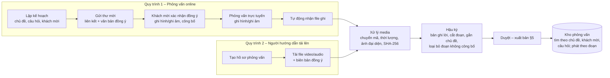

# 04 – Luồng 3: Cung cấp học liệu, phỏng vấn và video hướng dẫn theo chủ đề

> Module `app/flows/learning` · API `/api/v2/learning` · Bảng `lrn_*` · Mã yêu cầu `LRN-Fxx` · Quy tắc `BR-3xx`
> Kế thừa và thay thế 3 nhóm chức năng của v1.1.0: Business Guide, Training Documents, Video Resources (ánh xạ: `07` §3).

> **Đã làm (Giai đoạn 18, 09/11/2026)** – `app/flows/learning/`, migration `0019` – **ngoài phạm vi học liệu gốc của tài liệu này** (theo yêu cầu Giai đoạn 18 – **CẦN XÁC NHẬN** vị trí trong đặc tả): hợp đồng đào tạo `lrn_training_contracts` (`DT-yyyy-nnnn`, khách hàng `md_parties` loại customer, người hướng dẫn `instructor`, người học `learner`, thời hạn, lịch học, học phí NUMERIC(18,2) + tiền tệ; `draft → active → completed`, hủy có lý do; `admin`, `manager` ghi; `business_manager` đọc; `instructor` – hợp đồng mình dạy; cổng `GET /api/v2/portal/training-contracts` – `customer` hợp đồng của khách hàng mình, `learner` hợp đồng mình học, không có bản nháp). Buổi học `lrn_sessions` (`admin`, `manager`, người hướng dẫn của hợp đồng tạo / hủy; trong thời hạn hợp đồng; đã điểm danh thì không hủy). Điểm danh + hoàn thành `lrn_attendance` – chỉ người hướng dẫn của hợp đồng, hợp đồng `active`, buổi đã bắt đầu; vắng không thể "hoàn thành"; nhật ký trước / sau. Cổng người học `GET /api/v2/portal/learning/sessions`. Sự kiện (luồng nhận 4, `mode = training`): `lrn.contract.activated`, `lrn.contract.closed`, EV-302 (ghi danh), `lrn.session.scheduled` / `lrn.session.cancelled`, EV-303 (đổi hoàn thành; thêm `completed`). Chấm điểm ở Luồng 4 (§1 – không thuộc Luồng 3).

## 1. Phạm vi

Cung cấp học liệu cho 3 nhóm đối tượng – **người học**, **người quản lý**, **người hướng dẫn** – được tổ chức theo **chủ đề** và gắn với **bước quy trình nghiệp vụ** của Luồng 1, để:
- người học học trước khi thực hành, tra cứu đúng lúc khi đang làm một bước;
- người quản lý tra cứu chuẩn nghiệp vụ, quy định khi kiểm soát, phê duyệt;
- người hướng dẫn biên soạn, tổ chức lộ trình học và theo dõi tiến độ.

**Không thuộc Luồng 3**: chấm điểm, KPI, bài kiểm tra (Luồng 4). Luồng 3 chỉ ghi nhận tiến độ học (đã xem, đã hoàn thành) và phát sự kiện.

## 2. Loại học liệu

| `resource_type` | Tên | Nội dung | Trường đặc thù |
|---|---|---|---|
| `GUIDE` | Hướng dẫn nghiệp vụ | Văn bản hướng dẫn thao tác một bước/quy trình (kế thừa Business Guide) | `body_markdown`, `process_code?`, `step_codes[]` |
| `ACADEMIC_DOC` | Tài liệu học thuật | Giáo trình, bài giảng, bài báo, sách chuyên khảo, văn bản pháp quy | Thông tin trích dẫn §3.2, `file_id` |
| `VIDEO` | Video hướng dẫn | Video thao tác, bài giảng (kế thừa Video Resources) | `video_file_id`, `thumbnail_file_id`, `duration_sec`, `chapters[]` (mốc thời gian – tiêu đề), `subtitle_file_id?` |
| `INTERVIEW` | Phỏng vấn | **Kho dữ liệu phỏng vấn dạng video hoặc audio** (chuyên gia, nhà quản lý doanh nghiệp logistics…) theo chủ đề, kèm bản ghi lời và các đoạn đã gắn chủ đề. Nhập vào kho theo 2 quy trình: (1) phỏng vấn online trên hệ thống rồi lưu bản ghi hình/ghi âm; (2) người hướng dẫn tải file từ tài khoản hệ thống | §3.3 |
| `CASE_STUDY` | Tình huống nghiệp vụ | Mô tả tình huống, câu hỏi thảo luận, gợi ý phân tích (dùng để học; **không** phải tình huống chấm điểm – loại đó thuộc Luồng 4) | `body_markdown`, `discussion_questions[]`, `attachments[]` |
| `TEMPLATE` | Mẫu chứng từ, biểu mẫu | Mẫu S/C, C/I, P/L, C/O, tờ khai, biên bản giao nhận… có chú giải | `file_id`, `doc_type?` (liên kết `md_document_types`), `annotations[]` |
| `REGULATION` | Văn bản pháp quy | Số hiệu, cơ quan ban hành, ngày ban hành, ngày hiệu lực, tình trạng hiệu lực | `legal_no`, `issuer`, `issued_date`, `effective_date`, `legal_status` (`in_force`/`amended`/`replaced`/`expired`), `replaced_by?` |

Vấn đáp đánh giá người học không thuộc loại `INTERVIEW`; chức năng đó thuộc Luồng 4 (`05` §4, phương thức `ORAL`).

## 3. Mô hình dữ liệu

### 3.1. `lrn_resources` – Học liệu (bảng chung) và bảng mở rộng theo loại

| Trường | Kiểu | B/T | Ghi chú |
|---|---|---|---|
| `resource_code` | VARCHAR(30), duy nhất | Hệ thống | `HL-yyyy-nnnn` |
| `resource_type` | ENUM §2 | B | |
| `title` | VARCHAR(300) | B | |
| `summary` | TEXT | B | Tóm tắt 50–300 từ (BR-302) |
| `language` | ENUM `vi`, `en` | B | |
| `level` | ENUM `basic`, `intermediate`, `advanced` | B | |
| `audiences[]` | `learner`, `manager`, `instructor` | B (≥ 1) | Đối tượng được thấy |
| `topic_codes[]` | → `lrn_topics` | B (≥ 1) | |
| `process_code`, `step_codes[]` | Tham chiếu `md_process_*` | T | Phục vụ gợi ý theo bước (OPS-F10) |
| `keywords[]` | | T | |
| `authors[]` | JSON (họ tên, đơn vị, vai trò) | B với `ACADEMIC_DOC`, `INTERVIEW` | |
| `copyright_holder`, `license` | VARCHAR | B | `internal`, `CC-BY-4.0`, `all_rights_reserved_with_permission`… (BR-303) |
| `version`, `status` | INT, ENUM | Hệ thống | §5 |
| `published_at`, `review_due_at` | TIMESTAMPTZ | Hệ thống | Hạn rà soát định kỳ (BR-304) |
| `reviewed_by`, `published_by` | → `sys_users` | Hệ thống | |

Bảng mở rộng: `lrn_guides`, `lrn_academic_docs`, `lrn_videos`, `lrn_interviews`, `lrn_case_studies`, `lrn_templates`, `lrn_regulations` (quan hệ 1–1 với `lrn_resources`, chứa trường đặc thù ở §2).

### 3.2. Thông tin trích dẫn tài liệu học thuật (`lrn_academic_docs`)

| Trường | Ghi chú |
|---|---|
| `publication_type` | `textbook`, `lecture_notes`, `journal_article`, `conference_paper`, `book`, `book_chapter`, `thesis`, `report`, `standard` |
| `publication_year`, `publisher`, `place` | |
| `journal_or_book_title`, `volume`, `issue`, `pages` | |
| `isbn`, `issn`, `doi`, `url`, `accessed_date` | `doi` kiểm tra định dạng `10.xxxx/...` |
| `citation_style_default` | `APA7` (mặc định), `IEEE`, `TCVN` – **CẦN XÁC NHẬN** chuẩn trích dẫn của trường |
| `citation_text` | Hệ thống sinh từ các trường trên, cho phép người biên soạn hiệu chỉnh |

### 3.3. Kho dữ liệu phỏng vấn

#### 3.3.1. Hai quy trình nhập dữ liệu

| Bước | Quy trình 1 – Phỏng vấn online | Quy trình 2 – Tải lên |
|---|---|---|
| Khởi tạo | `instructor` tạo phiên phỏng vấn: chủ đề, bộ câu hỏi dự kiến (`interview_guide`), hình thức `video`/`audio`, thời gian, khách mời (họ tên, email, chức danh, đơn vị) | `instructor` tạo hồ sơ phỏng vấn với các thông tin tương tự (ngày, địa điểm/hình thức đã phỏng vấn) |
| Đồng ý của khách mời | Hệ thống gửi thư mời có liên kết riêng (token dùng một lần, hết hạn khi phiên kết thúc). Khách mời **không cần tài khoản**; trước khi vào phòng phải đọc và xác nhận văn bản đồng ý ghi hình/ghi âm và cho phép công bố cho mục đích đào tạo. Hệ thống lưu thời điểm, IP, phiên bản văn bản đồng ý | `instructor` tải **biên bản đồng ý** đã ký (bắt buộc, BR-305) |
| Ghi dữ liệu | Phòng họp trực tuyến; chỉ bắt đầu ghi khi mọi người tham gia đã đồng ý (BR-308); hiển thị biểu tượng đang ghi; kết thúc phiên → hệ thống tự nhận file ghi | `instructor` tải file video/audio từ tài khoản; file lớn tải theo từng phần, tải tiếp được khi mất kết nối |
| Xử lý media | **Chung**: kiểm tra MIME; chuyển mã chuẩn (video MP4 H.264/AAC; audio M4A/AAC); trích audio từ video để làm bản ghi lời; tính thời lượng; tạo ảnh đại diện (video); SHA-256. Giữ cả file gốc và file chuẩn hóa | |
| Hậu kỳ | **Chung**: bản ghi lời tự động bằng **dịch vụ chuyển giọng nói thành văn bản đặt tại máy chủ đơn vị** (§3.3.1b), người hướng dẫn hiệu đính hoặc nhập tay; cắt đoạn theo câu hỏi, gắn chủ đề; đánh dấu khoảng thời gian **không công bố** (bị bỏ qua khi phát; có thể xuất bản file đã cắt) | |
| Xuất bản | **Chung**: quy trình duyệt – xuất bản §5 | |

#### 3.3.1a. Phòng phỏng vấn online – WebRTC tự triển khai (đã chốt)

Phòng phỏng vấn nhúng trong ứng dụng, chạy trên máy chủ của đơn vị; **toàn bộ luồng media và file ghi nằm trên hạ tầng của đơn vị**, không qua nền tảng họp bên thứ ba.

| Thành phần | Chức năng | Ghi chú triển khai |
|---|---|---|
| Máy chủ media SFU (Selective Forwarding Unit) | Nhận và chuyển tiếp luồng audio/video giữa người tham gia | Đề xuất **LiveKit** (mã nguồn mở, có API quản lý phòng và dịch vụ ghi Egress); phương án thay thế: Jitsi Videobridge + Jibri. Chọn chính thức sau thử nghiệm (PoC) ở Giai đoạn 1b (`07` §5) |
| Dịch vụ ghi (recording/egress) | Ghi tổng hợp phòng (room composite) ra MP4, hoặc chỉ ghi âm (audio-only) với hình thức `audio`; ghi trực tiếp vào `StorageBackend` của hệ thống (`06` §2.6) | Gửi webhook (có chữ ký) cho ứng dụng khi bắt đầu/kết thúc/lỗi ghi |
| Máy chủ TURN/STUN (vd. coturn) | Vượt NAT/tường lửa cho khách mời ở mạng doanh nghiệp | Bắt buộc; có cổng TCP/TLS 443 dự phòng khi UDP bị chặn |
| Backend ứng dụng (Luồng 3) | Tạo/đóng phòng, cấp **token vào phòng** (ký bằng khóa API của máy chủ media, hạn ngắn), ra lệnh bắt đầu/dừng ghi, nhận webhook, tạo bản ghi `lrn_interview_media` | Kiểm tra đồng ý **phía máy chủ**: không cấp token cho khách chưa xác nhận đồng ý; không cho lệnh ghi khi còn người chưa đồng ý (BR-308) |
| Giao diện phòng (frontend) | Camera/micro, chia sẻ màn hình, biểu tượng đang ghi, danh sách câu hỏi dự kiến (chỉ người phỏng vấn thấy) | Hỗ trợ bản mới nhất của Chrome, Edge, Firefox, Safari trên máy tính và di động – **CẦN XÁC NHẬN** danh sách tối thiểu |

Quy định vận hành (giá trị mặc định cấu hình được – **CẦN XÁC NHẬN**): tối đa 6 người/phòng; tối đa 3 giờ/phiên; phòng tự đóng 15 phút sau khi người cuối rời đi; mã hóa đường truyền DTLS-SRTP (mặc định của WebRTC), báo hiệu qua HTTPS/WSS; thông tin đăng nhập TURN cấp theo phiên, hết hạn khi phiên kết thúc.

Năng lực hạ tầng (băng thông, CPU cho dịch vụ ghi, dung lượng lưu trữ) **xác định bằng thử nghiệm tải trong PoC**, không ước lượng trước trong đặc tả.

Lớp `InterviewRecorder` đóng gói việc gọi máy chủ media, để đổi giữa LiveKit và Jitsi không ảnh hưởng phần còn lại của Luồng 3.

#### 3.3.1b. Chuyển giọng nói thành văn bản – đặt tại máy chủ đơn vị (đã chốt)

Bản ghi lời tiếng Việt được tạo **trên máy chủ của đơn vị**; file audio không gửi ra dịch vụ bên ngoài (cùng nguyên tắc dữ liệu với §3.3.1a).

| Hạng mục | Quy định |
|---|---|
| Động cơ nhận dạng | Mô hình nhận dạng tiếng nói mã nguồn mở chạy cục bộ, hỗ trợ tiếng Việt. Ứng viên: họ mô hình Whisper (chạy qua `faster-whisper`), các mô hình Whisper tinh chỉnh cho tiếng Việt (vd. PhoWhisper). Chọn chính thức sau PoC ở Giai đoạn 1b, đo **tỷ lệ lỗi từ (WER)** trên bộ mẫu phỏng vấn nghiệp vụ logistics do người hướng dẫn chuẩn bị và **thời gian xử lý / 1 giờ audio** trên phần cứng của đơn vị |
| Lớp trừu tượng | `TranscriptionEngine` (đổi mô hình không ảnh hưởng phần còn lại của Luồng 3) |
| Xử lý | Tác vụ nền: chuẩn hóa audio (mono, 16 kHz) → nhận dạng theo đoạn → gắn mốc thời gian từng câu → lưu `transcript_markdown`, `transcript_source = auto`; người hướng dẫn hiệu đính → `auto_edited` |
| Từ điển chuyên ngành | Danh sách thuật ngữ, từ viết tắt (C/O, B/L, Incoterms, FCL, LCL, HS…) do người hướng dẫn quản lý, dùng làm gợi ý ngữ cảnh khi nhận dạng (nếu động cơ hỗ trợ) và để kiểm tra chính tả sau nhận dạng |
| Phần cứng | Khuyến nghị máy chủ có GPU cho thời gian xử lý chấp nhận được; cấu hình cụ thể xác định bằng kết quả PoC, không ước lượng trước |
| Bảo mật | Engine chạy trong mạng nội bộ, không mở cổng ra Internet; file tạm xóa sau khi xử lý |

#### 3.3.2. Dữ liệu

| Bảng | Trường chính |
|---|---|
| `lrn_interviews` (mở rộng 1–1 của `lrn_resources`) | `capture_method` (`online_recorded` / `uploaded`), `media_kind` (`video`/`audio`), `interview_date`, `location_or_platform`, `interviewer_ids[]`, `interview_guide` (câu hỏi dự kiến), `capture_status` (§3.3.3), `transcript_markdown` hoặc `transcript_file_id`, `transcript_source` (`auto`/`manual`/`auto_edited`), `duration_sec` |
| `lrn_interview_sessions` (chỉ Quy trình 1) | `interview_id`, `scheduled_start`, `scheduled_end`, `media_server` (`livekit`/`jitsi`), `room_name`, `egress_id`, `join_url`, `host_id`, `started_at`, `ended_at`, `recording_started_at`, `recording_ended_at`, `status` |
| `lrn_interview_participants` | `interview_id`, `full_name`, `email`, `organization`, `job_title`, `role` (`interviewer`/`interviewee`), `invite_token_hash`, `token_expires_at`, `consent_given_at`, `consent_ip`, `consent_text_version`, `consent_file_id` (Quy trình 2, hoặc bản ký bổ sung) |
| `lrn_interview_media` | `interview_id`, `file_id`, `variant` (`original`/`normalized`/`audio_extract`/`thumbnail`/`published_cut`), `duration_sec`, `codec`, `size_bytes` |
| `lrn_interview_segments` | `interview_id`, `start_sec`, `end_sec`, `question`, `answer_summary`, `topic_codes[]`, `keywords[]`, `is_public` (đoạn không công bố → `false`) |

#### 3.3.3. Trạng thái thu nhận (`capture_status`)

- Quy trình 1: `planned` → `invited` → `in_session` → `processing` → `post_production` → `ready`; `planned`/`invited` → `cancelled`; nhận file ghi thất bại → `recording_failed` (cho phép tải file lên thủ công, chuyển sang Quy trình 2).
- Quy trình 2: `uploading` → `processing` → `post_production` → `ready`.
- Học liệu chỉ được `:submit` vào quy trình duyệt – xuất bản (§5) khi `capture_status = ready`.

### 3.4. Chủ đề (`lrn_topics`)

Cây chủ đề nhiều cấp (`topic_code`, `parent_code`, `name_vi`, `name_en`, `description`, `sort_order`). Cây khởi tạo đề xuất (**CẦN XÁC NHẬN** theo chương trình đào tạo):

| Cấp 1 | Cấp 2 (ví dụ) |
|---|---|
| `T01` Hợp đồng và điều kiện thương mại | Hợp đồng mua bán quốc tế; Incoterms® 2020; Hợp đồng dịch vụ logistics và SLA |
| `T02` Chứng từ thương mại và vận tải | C/I, P/L; C/O và quy tắc xuất xứ; C/Q; B/L, AWB; Kiểm tra chéo bộ chứng từ |
| `T03` Thủ tục hải quan | Phân loại HS; Trị giá hải quan; Khai báo điện tử; Phân luồng, kiểm tra thực tế; Chính sách mặt hàng |
| `T04` Vận tải và giao nhận | Đường biển FCL/LCL; Hàng không; Đường bộ; Vận tải đa phương thức |
| `T05` Kho bãi và phân phối | Nhập kho; Quản lý tồn kho; Xuất kho, phân phối |
| `T06` Quản lý vận hành và kiểm soát | Lập kế hoạch triển khai hợp đồng; Kiểm soát 4 mắt; Quản lý sự cố, CAPA; Quản lý rủi ro |
| `T07` Đo lường hiệu quả | KPI vận hành logistics; Perfect Order; Cải tiến liên tục |

### 3.5. Lộ trình học, lớp và tiến độ

| Bảng | Nội dung |
|---|---|
| `lrn_courses` | Khóa/học phần: `course_code`, `name`, `description`, `credits?`, `owner_instructor_id`, `status` |
| `lrn_course_items` | Danh sách học liệu có thứ tự: `resource_id`, `seq`, `is_required`, `min_completion` (vd. video ≥ 90% thời lượng) |
| `lrn_cohorts` | Lớp/khóa tổ chức: `cohort_code`, `course_id`, `start_date`, `end_date`, `instructor_ids[]` |
| `lrn_enrollments` | `cohort_id`, `learner_id`, `enrolled_at`, `status` (`active`/`completed`/`withdrawn`) – phát EV-302 |
| `lrn_progress` | `learner_id`, `resource_id`, `course_id?`, `first_viewed_at`, `last_position_sec` (video), `percent_complete`, `completed_at` – phát EV-303 khi đạt `min_completion` |
| `lrn_feedback` | Đánh giá học liệu 1–5 sao, góp ý; `instructor` xử lý |

## 4. Quy tắc nghiệp vụ

| Mã | Quy tắc |
|---|---|
| **BR-301** | Chỉ học liệu `published` và có `audiences` chứa vai trò của người dùng mới hiển thị với người dùng đó |
| **BR-302** | Không xuất bản khi thiếu: tóm tắt, ít nhất 1 chủ đề, thông tin bản quyền; với `ACADEMIC_DOC`: tác giả + năm + (ISBN hoặc DOI hoặc URL hoặc nhà xuất bản) |
| **BR-303** | Tài liệu có bản quyền bên thứ ba chỉ được tải lên khi có giấy phép/đồng ý; nếu không, chỉ lưu **thông tin trích dẫn + liên kết**, không lưu file |
| **BR-304** | `REGULATION` và `GUIDE` có `review_due_at` (mặc định 12 tháng); quá hạn → nhắc người biên soạn; `REGULATION` có `legal_status ≠ in_force` hiển thị nhãn "Hết hiệu lực/Đã sửa đổi" kèm văn bản thay thế |
| **BR-305** | Phỏng vấn chỉ xuất bản khi **mọi** người được phỏng vấn có bằng chứng đồng ý: xác nhận điện tử trước phiên (Quy trình 1) hoặc biên bản đồng ý đã ký (Quy trình 2). Người được phỏng vấn rút lại đồng ý → học liệu chuyển `archived` ngay, file không còn phát được |
| **BR-306** | Sửa học liệu đã xuất bản tạo phiên bản mới (`version + 1`); tiến độ học gắn theo `resource_id`, không mất khi đổi phiên bản |
| **BR-307** | Gợi ý theo bước (`find_resources(step_code)`) xếp hạng: khớp `step_codes` > khớp `process_code` > khớp `topic_codes` của bước; trong cùng hạng ưu tiên `GUIDE`, `TEMPLATE`, `VIDEO` |
| **BR-308** | Phỏng vấn online: hệ thống chỉ cho bắt đầu ghi khi mọi người tham gia đã xác nhận đồng ý; người tham gia vào phòng muộn phải xác nhận trước khi được nhận luồng âm thanh/hình ảnh của phòng đang ghi |
| **BR-309** | Liên kết mời khách: token ngẫu nhiên ≥ 128 bit, chỉ lưu giá trị băm, dùng cho đúng một phiên, hết hạn khi phiên kết thúc; email, số điện thoại của khách mời không hiển thị với `learner` |
| **BR-310** | File gốc của phỏng vấn (`variant = original`) chỉ `instructor`, `content_editor` truy cập; người học chỉ phát file đã chuẩn hóa hoặc đã cắt (`normalized`, `published_cut`), bỏ qua các đoạn `is_public = false` |

## 5. Quy trình biên soạn – xuất bản

`draft` → (`:submit`) `in_review` → (`:approve`) `published` → (`:archive`) `archived`; `in_review` → (`:reject`, kèm nhận xét) `draft`. Người duyệt ≠ người biên soạn (**CẦN XÁC NHẬN** có áp dụng cho đơn vị nhỏ không).

## 6. Yêu cầu chức năng

| Mã | Yêu cầu | Ưu tiên |
|---|---|---|
| LRN-F01 | Quản lý cây chủ đề | Cao |
| LRN-F02 | Biên soạn học liệu 7 loại; tải file theo `06` §2.6; quy trình duyệt – xuất bản | Cao |
| LRN-F03 | Tìm kiếm: toàn văn (tiêu đề, tóm tắt, từ khóa, bản ghi phỏng vấn), lọc theo chủ đề, loại, cấp độ, đối tượng, bước quy trình | Cao |
| LRN-F04 | Phát video có chương, phụ đề, nhớ vị trí xem; phát đoạn phỏng vấn theo chủ đề | Cao |
| LRN-F05 | Sinh trích dẫn theo chuẩn đã chọn; xuất danh mục tài liệu tham khảo của một khóa | Trung bình |
| LRN-F06 | Khóa học, lớp, ghi danh (nhập danh sách từ XLSX/CSV) | Cao |
| LRN-F07 | Theo dõi tiến độ học của người học; báo cáo tiến độ lớp cho người hướng dẫn | Cao |
| LRN-F08 | Giao diện đọc `find_resources` cho Luồng 1, Luồng 2 | Cao |
| LRN-F09 | Phản hồi, đánh giá học liệu | Thấp |
| LRN-F10 | Quy trình 1 – phỏng vấn online: lập lịch, mời khách, xác nhận đồng ý, phòng phỏng vấn, ghi hình/ghi âm, tự nhận file ghi | Cao |
| LRN-F11 | Quy trình 2 – tải lên file phỏng vấn từ tài khoản người hướng dẫn (tải theo phần, tải tiếp khi mất kết nối) kèm biên bản đồng ý | Cao |
| LRN-F12 | Xử lý media nền (chuyển mã, trích audio, ảnh đại diện) và hậu kỳ: bản ghi lời, cắt đoạn, gắn chủ đề, đánh dấu đoạn không công bố | Cao |
| LRN-F13 | Kho phỏng vấn: tìm theo chủ đề, khách mời, đơn vị, nội dung câu hỏi/bản ghi lời; phát theo đoạn | Cao |

## 7. API (tóm tắt)

| Phương thức | Đường dẫn | Mô tả |
|---|---|---|
| GET/POST | `/api/v2/learning/topics` · PATCH `/topics/{code}` | |
| GET/POST | `/api/v2/learning/resources` | Lọc `type`, `topic`, `level`, `audience`, `step_code`, `q`, `status` |
| GET/PATCH | `/api/v2/learning/resources/{id}` | |
| POST | `/api/v2/learning/resources/{id}/files` | Tải file (multipart, theo loại) |
| POST | `/api/v2/learning/resources/{id}:submit` · `:approve` · `:reject` · `:archive` | |
| GET | `/api/v2/learning/resources/{id}/citation?style=APA7` | |
| POST | `/api/v2/learning/interviews` | Tạo hồ sơ phỏng vấn; body `capture_method` = `online_recorded` (Quy trình 1) hoặc `uploaded` (Quy trình 2) |
| POST | `/api/v2/learning/interviews/{id}/sessions` · `/sessions/{sid}:invite` · `:start` · `:start-recording` · `:end` | Quy trình 1 |
| GET/POST | `/api/v2/learning/interview-invitations/{token}` · `{token}:consent` | Trang khách mời (không cần đăng nhập, chỉ bằng token – BR-309) |
| POST | `/api/v2/learning/interviews/{id}/sessions/{sid}/room-token` | Cấp token vào phòng (người phỏng vấn: theo tài khoản; khách: theo token mời đã đồng ý) |
| POST | `/api/v2/learning/recordings/webhook` | Nhận sự kiện ghi từ máy chủ media (xác thực chữ ký) |
| POST | `/api/v2/learning/interviews/{id}/media` | Quy trình 2: tải file (tải theo phần), kèm biên bản đồng ý |
| PUT | `/api/v2/learning/interviews/{id}/transcript` · `/segments` | Hậu kỳ |
| GET | `/api/v2/learning/interviews?topic=&interviewee=&organization=&q=` · `/interviews/{id}/segments?topic=T02` | Kho phỏng vấn |
| GET/POST | `/api/v2/learning/courses` · `/courses/{id}/items` | |
| GET/POST | `/api/v2/learning/cohorts` · `/cohorts/{id}/enrollments` (JSON hoặc file XLSX) | |
| PUT | `/api/v2/learning/progress/{resource_id}` | Người học cập nhật vị trí/tỷ lệ hoàn thành |
| GET | `/api/v2/learning/cohorts/{id}/progress` | Báo cáo tiến độ lớp |

## 8. Sự kiện

- **Phát**: EV-301, EV-302, EV-303.
- **Nhận**: EV-402 (hiển thị kết quả học tập trong trang khóa học của người học – chỉ đọc).

## 9. Điểm CẦN XÁC NHẬN

1. Giới hạn phòng, thời lượng phiên, danh sách trình duyệt tối thiểu (§3.3.1a). Đã chốt: phòng họp WebRTC tự triển khai; chuyển giọng nói thành văn bản đặt tại máy chủ đơn vị (§3.3.1b) – mô hình cụ thể chọn sau PoC.
2. Chuẩn trích dẫn tài liệu (APA 7 / IEEE / TCVN) theo quy định của trường.
3. Cây chủ đề theo chương trình đào tạo hiện hành.
4. Có cần duyệt 2 người (biên soạn ≠ duyệt) không.
5. Lưu trữ video: máy chủ nội bộ hay dịch vụ ngoài (YouTube không công khai, Vimeo…); ảnh hưởng dung lượng và băng thông.
