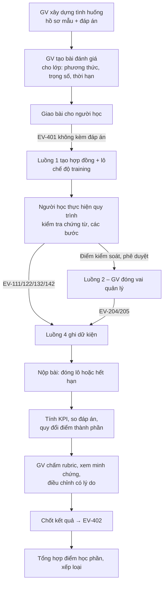

# 05 – Luồng 4: Kiểm tra, đánh giá kết quả thực hiện nghiệp vụ (KPI) và kết quả học tập

> Module `app/flows/assessment` · API `/api/v2/assessment` · Bảng `asm_*` · Mã yêu cầu `ASM-Fxx` · Quy tắc `BR-4xx`

## 1. Phạm vi

1. **Danh mục KPI và tính toán KPI** – nơi duy nhất tính KPI trong hệ thống (BR-05), cho cả hai chế độ:
   - `production`: đánh giá kết quả vận hành của nhân viên, hợp đồng; cảnh báo cho Luồng 2.
   - `training`: đánh giá kết quả thực hành của người học.
2. **Tổ chức kiểm tra, đánh giá người học**: tình huống thực hành (kèm đáp án), trắc nghiệm, vấn đáp, chấm theo tiêu chí (rubric).
3. **Quy đổi KPI thành điểm** và tổng hợp **kết quả học tập**.

Luồng 4 có bảng dữ kiện riêng (`asm_fact_*`) dựng từ sự kiện EV-1xx, EV-2xx, EV-3xx; không đọc bảng của luồng khác (N2, N4).

## 2. Luồng nghiệp vụ đánh giá người học

## 3. Danh mục KPI (`asm_kpi_definitions`)

| Mã | KPI | Công thức | Đơn vị | Chiều tốt | Cấp đo | Nguồn |
|---|---|---|---|---|---|---|
| KPI-01 | Tỷ lệ bộ chứng từ đạt ngay lần kiểm tra đầu (Document First-Time-Right) | Số lô có lần kiểm tra `run_no = 1` với `blocking_count = 0` ÷ số lô đã kiểm tra | % | Cao | nhân viên, hợp đồng | EV-122 |
| KPI-02 | Thời gian xử lý bộ chứng từ | Thời điểm lô chuyển `docs_verified` − thời điểm nhận chứng từ đầu tiên (trung vị) | giờ | Thấp | nhân viên, hợp đồng, người học | EV-121, EV-112 |
| KPI-03 | Tỷ lệ bước hoàn thành đúng hạn | Số bước `actual_end ≤ planned_end` ÷ số bước hoàn thành | % | Cao | nhân viên, người học | EV-132 |
| KPI-04 | Tỷ lệ tuân thủ quy trình | Số bước có `sequence_ok ∧ evidence_ok` ÷ số bước hoàn thành | % | Cao | nhân viên, người học | EV-132 |
| KPI-05 | Tỷ lệ đạt điểm kiểm soát lần đầu | Số điểm kiểm soát `passed` ở `attempt_no = 1` ÷ số điểm kiểm soát đã đánh giá (lần đầu) | % | Cao | nhân viên, người học | EV-204 |
| KPI-06 | Thời gian thông quan | `cleared_at − submitted_at` (trung vị; tách theo luồng xanh/vàng/đỏ) | giờ | Thấp | hợp đồng | EV-141 |
| KPI-07 | Tỷ lệ giao hàng đúng hạn (On-Time Delivery) | Số lô `delivered_at ≤ sla_due_at` ÷ số lô đã giao | % | Cao | hợp đồng, nhân viên | EV-142 |
| KPI-08 | Tỷ lệ giao đủ, nguyên vẹn | Số lô `in_full ∧ damage_free` ÷ số lô đã giao | % | Cao | hợp đồng | EV-142 |
| KPI-09 | Tỷ lệ đơn hàng hoàn hảo (Perfect Order) | Số lô đồng thời: đúng hạn ∧ đủ ∧ nguyên vẹn ∧ không có sự cố loại `DOCUMENT_ERROR` ÷ số lô đã giao | % | Cao | hợp đồng | EV-142, EV-205 |
| KPI-10 | Tỷ lệ lô có sự cố | Số lô có ≥ 1 sự cố ÷ số lô | % | Thấp | hợp đồng, nhân viên | EV-205 |
| KPI-11 | Tỷ lệ phát hiện sai lệch cài sẵn (chỉ `training`) | Số sai lệch trong đáp án được người học ghi nhận đúng (khớp `rule_code` + chứng từ + trường) ÷ số sai lệch trong đáp án | % | Cao | người học | EV-122 (`source = manual`) + đáp án |
| KPI-12 | Tỷ lệ báo sai (chỉ `training`) | Số sai lệch người học ghi nhận không có trong đáp án ÷ số sai lệch người học ghi nhận | % | Thấp | người học | như trên |
| KPI-13 | Mức hoàn thành học liệu bắt buộc | Số học liệu bắt buộc đã hoàn thành ÷ số học liệu bắt buộc của khóa | % | Cao | người học | EV-302, EV-303 |
| KPI-14 | Tỷ lệ phản hồi yêu cầu dịch vụ đúng hạn | Số yêu cầu có `decided_at ≤ response_due_at` ÷ số yêu cầu đã quyết định (kèm trung vị thời gian phản hồi, giờ) | % | Cao | hợp đồng, nhân viên, người học | EV-113, EV-114 |

Ghi chú:
- KPI-09 là cách vận dụng chỉ tiêu Perfect Order Fulfillment của mô hình SCOR vào dữ liệu hiện có. Định nghĩa "đủ chứng từ đúng" ở đây là **CẦN XÁC NHẬN**.
- Mỗi KPI có `formula_key` trỏ tới hàm tính trong code (đăng ký trong `registry`), `version`, `default_target`, `default_floor`, `warning_threshold`. Đổi công thức → tăng `version`; số đo cũ giữ nguyên `kpi_version`.
- Mẫu số = 0 → giá trị `null` (không tính điểm, không cảnh báo), không trả 0.

## 4. Phương thức đánh giá

| `method` | Tên | Nội dung | Điểm thành phần |
|---|---|---|---|
| `PRACTICAL_SCENARIO` | Thực hành nghiệp vụ theo tình huống | Người học thực hiện lô hàng `training` sinh từ tình huống | KPI quy đổi (§5) + rubric |
| `QUIZ` | Trắc nghiệm / tự luận ngắn | Ngân hàng câu hỏi theo chủ đề (`topic_codes` Luồng 3) | Tự chấm (trắc nghiệm), GV chấm (tự luận) |
| `ORAL` | Vấn đáp | Phiên vấn đáp có người hỏi, bộ câu hỏi, tiêu chí; có thể ghi âm/ghi hình | Rubric |
| `INSTRUCTOR_RUBRIC` | Đánh giá theo tiêu chí | Đánh giá quá trình, báo cáo, thuyết trình | Rubric |

## 5. Quy đổi KPI thành điểm

Thang điểm thành phần 0–10. Với mỗi KPI dùng trong bài đánh giá có `floor` (mức không điểm) và `target` (mức đạt 10):

- KPI chiều **cao là tốt**: `điểm = 10 × min(max((v − floor) / (target − floor), 0), 1)`
- KPI chiều **thấp là tốt**: `điểm = 10 × min(max((floor − v) / (floor − target), 0), 1)`

Điểm bài = Σ (trọng số × điểm thành phần); làm tròn 1 chữ số thập phân **khi chốt**, không làm tròn ở bước trung gian.

**Ví dụ minh họa** – bài thực hành `QT-NK-SEA-FCL`, tình huống có 5 sai lệch cài sẵn. Trọng số, ngưỡng là **giá trị minh họa – CẦN XÁC NHẬN**:

| Thành phần | Trọng số | floor → target | Kết quả người học | Điểm | Điểm × trọng số |
|---|---|---|---|---|---|
| KPI-11 Phát hiện sai lệch | 30% | 50% → 100% | 4/5 = 80% | 6,0 | 1,800 |
| KPI-12 Báo sai | 10% | 50% → 0% | 1/5 = 20% | 6,0 | 0,600 |
| KPI-03 Đúng hạn | 15% | 60% → 100% | 9/10 = 90% | 7,5 | 1,125 |
| KPI-04 Tuân thủ quy trình | 15% | 60% → 100% | 10/10 = 100% | 10,0 | 1,500 |
| KPI-05 Đạt kiểm soát lần đầu | 10% | 50% → 100% | 3/4 = 75% | 5,0 | 0,500 |
| Rubric của người hướng dẫn | 20% | – | 8,0 | 8,0 | 1,600 |
| **Tổng** | 100% | | | | **7,125 → 7,1** |

Điểm học phần = Σ (trọng số bài đánh giá × điểm bài). Quy đổi điểm chữ theo thang cấu hình; mặc định: A 8,5–10; B 7,0–8,4; C 5,5–6,9; D 4,0–5,4; F < 4,0 – **CẦN XÁC NHẬN** theo quy chế đào tạo của cơ sở đào tạo (quy chế đào tạo trình độ đại học theo Thông tư 08/2021/TT-BGDĐT và quy định cụ thể của trường). Ví dụ trên đạt 7,1 → **B**.

## 6. Mô hình dữ liệu

| Bảng | Trường chính |
|---|---|
| `asm_kpi_definitions` | `kpi_code`, `version`, `name`, `description`, `formula_key`, `unit`, `direction` (`higher_better`/`lower_better`), `subject_levels[]`, `modes[]`, `default_floor`, `default_target`, `warning_threshold`, `status` |
| `asm_kpi_targets` | `kpi_code`, `subject_type` (`contract`), `subject_id`, `target_value`, `warning_threshold`, `source_plan_id`, `valid_from` – từ EV-201 |
| `asm_fact_shipments`, `asm_fact_tasks`, `asm_fact_document_checks`, `asm_fact_discrepancies`, `asm_fact_checkpoints`, `asm_fact_incidents`, `asm_fact_learning` | Bảng dữ kiện dựng từ sự kiện; có `mode`, `event_id` nguồn (idempotent) |
| `asm_measurements` | `kpi_code`, `kpi_version`, `subject_type` (`staff`, `learner`, `shipment`, `contract`, `cohort`), `subject_id`, `mode`, `period_start`, `period_end`, `numerator`, `denominator`, `value`, `calc_run_id`, `computed_at` – **không sửa**, tính lại sinh bản ghi mới với `calc_run_id` mới |
| `asm_calc_runs` | `run_id`, `trigger` (`schedule`/`assessment_submit`/`manual`), `started_at`, `finished_at`, `status` |
| `asm_scenarios` | `scenario_code`, `version`, `title`, `learning_objectives[]`, `topic_codes[]`, `process_code`, `ruleset_code`, `ruleset_version` (bộ quy tắc `training` dùng cho tình huống – `02` §5.3), `difficulty`, `time_limit_hours`, `contract_payload`, `shipment_payload`, `document_payloads[]` (kèm `file_id`), `answer_key` (JSON: `seeded_discrepancies[]` – `rule_code`, `doc_type`, `field`, `line_no?`, `explanation`; `expected_decisions[]`), `auto_check_visible` (mặc định `false`), `status` |
| `asm_rubrics`, `asm_rubric_criteria` | Tiêu chí, trọng số, mô tả 4 mức (Chưa đạt / Đạt / Khá / Giỏi) và khoảng điểm tương ứng |
| `asm_assessments` | `cohort_id`, `course_id`, `title`, `method`, `weight_in_course`, `open_at`, `close_at`, `scenario_id?`, `quiz_id?`, `rubric_id?`, `components` (JSON: KPI/tiêu chí, trọng số, floor, target), `status` (`draft`/`published`/`closed`) |
| `asm_assignments` | `assessment_id`, `learner_id`, `scenario_id`, `ops_shipment_id` (từ EV-111 có `scenario_assignment_id`), `status` (§7), `assigned_at`, `due_at`, `submitted_at` |
| `asm_quiz_*` | Ngân hàng câu hỏi (`question`, `type`, `options`, `answer`, `topic_codes`, `difficulty`), đề, lượt làm, câu trả lời |
| `asm_oral_sessions` | `assignment_id`, `examiner_ids[]`, `scheduled_at`, `questions[]`, `recording_file_id?`, `notes` |
| `asm_scores` | `assignment_id`, `component_code` (mã KPI / mã tiêu chí / `QUIZ`), `raw_value`, `points`, `weight`, `scored_by` (`system`/user), `override_points?`, `override_reason?` |
| `asm_results` | `assignment_id`, `learner_id`, `assessment_id`, `score`, `grade`, `finalized_by`, `finalized_at`, `appeal_status` |
| `asm_course_results` | `cohort_id`, `learner_id`, `score`, `grade`, `finalized_at` |

## 7. Trạng thái bài làm

`assigned` → `in_progress` (EV-111/EV-131 đầu tiên của lô) → `submitted` (lô `closed`, hoặc người học bấm nộp, hoặc **hết `due_at` – tự nộp**) → `auto_scored` (tính KPI xong) → `graded` (GV chấm rubric) → `finalized` (chốt, phát EV-402) → (`:appeal`) `under_appeal` → `finalized`.

## 8. Quy tắc nghiệp vụ

| Mã | Quy tắc |
|---|---|
| **BR-401** | Đáp án (`answer_key`) không bao giờ rời Luồng 4: không có trong EV-401, không trả về qua API cho `learner`, không có trong `public.py` |
| **BR-402** | Ở chế độ `training` với `auto_check_visible = false`: người học tự ghi nhận sai lệch (`source = manual`, `02` BR-105); kết quả kiểm tra tự động chỉ người hướng dẫn xem được |
| **BR-403** | Dữ kiện sau thời điểm `submitted_at` không được tính vào bài làm |
| **BR-404** | Điều chỉnh điểm do hệ thống tính phải có `override_reason`; ghi nhật ký; người học thấy được lý do |
| **BR-405** | Kết quả `finalized` không sửa trực tiếp; chỉ thay đổi qua phúc khảo. Thời hạn phúc khảo mặc định 7 ngày – **CẦN XÁC NHẬN** |
| **BR-406** | Tổng trọng số thành phần của một bài đánh giá = 100%; tổng `weight_in_course` các bài của một khóa = 100% – kiểm tra khi `published` |
| **BR-407** | KPI vận hành (`production`) tính định kỳ hằng ngày lúc 01:00 (`Asia/Ho_Chi_Minh`), theo kỳ tuần/tháng/quý; giá trị dưới `warning_threshold` của mục tiêu hợp đồng → phát EV-403 |
| **BR-409** | Mọi `rule_code` trong `answer_key` phải tồn tại trong bộ quy tắc (`ruleset_code`, `ruleset_version`) của tình huống; kiểm tra khi lưu tình huống và khi bộ quy tắc được công bố phiên bản mới (tình huống tham chiếu phiên bản cụ thể nên không bị ảnh hưởng, chỉ cảnh báo khi người hướng dẫn nâng phiên bản) |
| **BR-408** | Một tình huống có thể giao cho nhiều người học; mỗi lượt giao sinh một lô `training` riêng; khuyến nghị tạo biến thể tình huống để hạn chế sao chép bài (**CẦN XÁC NHẬN** có sinh biến thể tự động không) |

## 9. Yêu cầu chức năng

| Mã | Yêu cầu | Ưu tiên |
|---|---|---|
| ASM-F01 | Quản lý danh mục KPI, phiên bản công thức | Cao |
| ASM-F02 | Tính KPI theo lịch và theo yêu cầu; truy vết số đo về dữ kiện gốc (lô, bước, lần kiểm tra) | Cao |
| ASM-F03 | Biên soạn tình huống: nhập hồ sơ mẫu (hợp đồng, lô, chứng từ, dòng hàng), đánh dấu sai lệch cài sẵn và giải thích | Cao |
| ASM-F04 | Tạo bài đánh giá cho lớp; chọn phương thức, thành phần, trọng số, ngưỡng; giao bài | Cao |
| ASM-F05 | Chấm tự động KPI-03, 04, 05, 11, 12 khi nộp bài | Cao |
| ASM-F06 | Màn hình chấm của người hướng dẫn: minh chứng (qua `operations.public`), so sánh đáp án – bài làm, rubric, điều chỉnh có lý do | Cao |
| ASM-F07 | Ngân hàng câu hỏi trắc nghiệm theo chủ đề; tạo đề, chấm tự động | Trung bình |
| ASM-F08 | Phiên vấn đáp: lịch, câu hỏi, chấm rubric | Trung bình |
| ASM-F09 | Chốt kết quả, phúc khảo, tổng hợp điểm học phần; xuất bảng điểm XLSX | Cao |
| ASM-F10 | Bảng điều khiển KPI vận hành theo hợp đồng/nhân viên/kỳ; phát cảnh báo EV-403 | Cao |
| ASM-F11 | Phân tích kết quả lớp: phân bố điểm, sai lệch hay bị bỏ sót nhất theo `rule_code` (đầu vào cải tiến học liệu Luồng 3) | Trung bình |

## 10. API (tóm tắt)

| Phương thức | Đường dẫn | Mô tả |
|---|---|---|
| GET/POST | `/api/v2/assessment/kpis` · PATCH `/kpis/{code}` | |
| GET | `/api/v2/assessment/kpi-values?kpi_code=&subject_type=&subject_id=&period=` | |
| POST | `/api/v2/assessment/calc-runs` | Tính lại theo yêu cầu (`admin`, `instructor`) |
| GET/POST | `/api/v2/assessment/scenarios` · GET/PATCH `/scenarios/{id}` | `answer_key` chỉ trả cho `instructor` |
| GET/POST | `/api/v2/assessment/assessments` · POST `/{id}:publish` · `:close` | |
| POST | `/api/v2/assessment/assessments/{id}/assignments` | Giao bài cho danh sách người học/cả lớp (→ EV-401) |
| GET | `/api/v2/assessment/assignments?learner_id=me` · `/assignments/{id}` | |
| POST | `/api/v2/assessment/assignments/{id}:submit` | |
| GET/PUT | `/api/v2/assessment/assignments/{id}/scores` | GV chấm rubric, điều chỉnh |
| POST | `/api/v2/assessment/assignments/{id}:finalize` · `:appeal` | |
| GET/POST | `/api/v2/assessment/quizzes` · `/quizzes/{id}/attempts` | |
| GET | `/api/v2/assessment/cohorts/{id}/results` · `/cohorts/{id}/results.xlsx` | |

## 11. Sự kiện

- **Phát**: EV-401, EV-402, EV-403.
- **Nhận**: EV-101, EV-102, EV-103, EV-113, EV-114, EV-111, EV-112, EV-121, EV-122, EV-131, EV-132, EV-141, EV-142 (Luồng 1); EV-201, EV-204, EV-205, EV-206 (Luồng 2); EV-302, EV-303 (Luồng 3).

**Đã làm (Giai đoạn 14, 09/11/2026)** – `app/flows/assessment/`:
- **Nhận sự kiện** từ Redis Stream `l3pl:events:assessment` qua bộ nhận dùng chung (consumer `assessment`, `sys_event_consumptions` – không xử lý trùng): EV-101, EV-111, EV-112, EV-142, EV-131, EV-132, EV-133, `ops.task.unblocked`, `ctl.task.started|completed|blocked|delayed|synced`, `ctl.alert.raised|escalated`. Sự kiện khác gửi tới Luồng 4 → `skipped` (chưa có xử lý).
- **Bảng dữ kiện** (migration `0015`, không FK sang bảng luồng khác): `asm_fact_contracts` (SLA từ EV-101), `asm_fact_shipments`, `asm_fact_tasks` (khóa theo id bước Luồng 2), `asm_fact_task_blocks` (mỗi lần bị chặn, UNIQUE bước + `revision`), `asm_fact_alerts`. Khử trùng giữa các sự kiện của cùng một thay đổi theo `revision` của bước (Luồng 2 nguồn chuẩn): sự kiện cũ hơn bỏ qua; EV-13x `origin = ops` (Luồng 1 tự đổi, Luồng 2 chưa xác nhận) chỉ lưu `performer_id`, `sequence_ok`, `evidence_ok` – trạng thái đợi `ctl.task.synced`.
- **KPI tính khi đọc** (chưa có `asm_measurements`, `asm_calc_runs`, lịch BR-407, EV-403), chỉ `production`: lô – KPI-07 tỉ lệ giao đúng hạn (`delivered_at ≤ sla_due_at`), giờ trễ trung bình / lớn nhất của lô trễ; bước – KPI-03 tỉ lệ đúng hạn (`actual_end ≤ planned_end`), giờ trễ trung bình / lớn nhất của bước trễ; số bước bị chặn, số lần chặn; số cảnh báo, critical, đã leo thang. Mẫu số 0 → `null`. Theo toàn bộ / hợp đồng / lô / nhân viên (người được giao bước; chưa có thì người thực hiện ở Luồng 1). Hợp đồng: so với SLA – điều khoản có `kpi_code` KPI-03, KPI-07 (%; đạt khi ≥ `target_value`); mã KPI khác → `computed = false`.
- **API** (`manager`, `business_manager`, `admin`; vai trò khác, `customer` → `403`): `GET /api/v2/assessment/kpi?from=&to=`, `/kpi/contracts`, `/kpi/contracts/{id}`, `/kpi/shipments` (lọc `contract_id`, phân trang), `/kpi/shipments/{id}`, `/kpi/staff`, `/kpi/staff/{user_id}`. Kỳ theo ngày giờ Việt Nam, gồm hai đầu; mặc định 30 ngày tới hôm nay; tối đa 366 ngày.
- Chưa làm (sau Giai đoạn 14): xem mục Giai đoạn 15 bên dưới.

**Đã làm (Giai đoạn 15, 09/11/2026)**:
- **Danh mục** `asm_kpi_definitions` (migration `0016` seed KPI-01…14 theo §3: tên, công thức, `formula_key`, đơn vị, chiều tốt, cấp đo, chế độ, sự kiện nguồn) – **không** có `default_target` / `default_floor` / `warning_threshold`: mục tiêu chỉ đến từ kế hoạch được duyệt.
- **Mục tiêu** `asm_kpi_targets` từ EV-201 (`kpi_code`, `target`, `warning_threshold`, `unit`, kế hoạch + phiên bản); mục tiêu hiện hành = bộ duyệt sau cùng của hợp đồng. Mã không có trong danh mục (vd. `KPI-CLR`) lưu nhưng không tính (`not_computed`).
- **Công thức** `formulas.py` cho KPI-01…10, 14 trên dữ liệu `production` (mẫu số 0 → `null`); KPI-11, 12, 13 chỉ `training` → `applicable = false`. Cấp đo: toàn bộ, hợp đồng, lô, nhân viên (KPI-06…10 không đo theo nhân viên – chưa có người phụ trách lô trong dữ kiện). KPI-02/06 là trung vị giờ (`numerator` = tổng giờ); KPI-06 kèm trung vị theo luồng xanh/vàng/đỏ; KPI-14 kèm trung vị giờ phản hồi. KPI-04: `evidence_ok` null (chưa kiểm chứng) coi là đạt – **CẦN XÁC NHẬN**. KPI-10: mẫu số = lô tạo trong kỳ.
- **Dữ kiện mới**: `asm_fact_document_checks` (EV-122, người kiểm = `actor_id`), `asm_fact_checkpoints` (EV-204), `asm_fact_customs` (EV-141), `asm_fact_incidents` (EV-205/206), `asm_fact_service_requests` (EV-113/114); `asm_fact_shipments` thêm thời điểm nhận chứng từ đầu (EV-121 – thêm luồng nhận 4) và chuyển `docs_verified` (EV-112, người chuyển). EV-113/114/121/122/141/204/205/206 **chưa có nơi phát** – hợp đồng dữ liệu đã có trong `contracts.py`.
- **Tính định kỳ** (BR-407): worker xếp tác vụ rq lúc `ASSESSMENT_KPI_CALC_HOUR` (mặc định 1) giờ Việt Nam, tính cho hôm qua – kỳ tuần (từ thứ Hai) / tháng / quý tính tới ngày đó, đối tượng `all` / `contract` / `staff` → `asm_fact_kpi_measurements` (chỉ thêm, trigger chặn sửa/xóa; tính lại = dòng mới, `calc_run_id` mới), `asm_calc_runs`. Lỗi → `failed` + nhật ký `kpi.calc_failed`, rq thử lại. `POST /kpi/calc-runs` (admin) tính ngay.
- **Cảnh báo EV-403**: số đo hợp đồng kém hơn mục tiêu → `warning`, kém hơn `warning_threshold` → `critical` (theo chiều tốt); mỗi (KPI, hợp đồng, kỳ) một lần (`asm_kpi_alerts`), nhật ký `kpi.alert`. Luồng 2 nhận EV-403 → cảnh báo `kpi_below_target` (không gắn lô) cho mọi `manager` + `business_manager`, email / Zalo qua hàng đợi; không leo thang BR-205.
- **API**: `kpis` (KPI-01…14) trong mọi báo cáo `/kpi*`; `targets` (mục tiêu hiện hành + trạng thái) trong báo cáo hợp đồng; `GET /kpi/definitions`, `/kpi/targets`, `/kpi/measurements` (mặc định lần tính mới nhất; `history=true`), `/kpi/calc-runs`, `/kpi/alerts`; `POST /kpi/calc-runs` (admin).
- Chưa làm: `public.get_kpi_values`, phần đánh giá người học (KPI-11/12/13 trên `training`).

**Đã làm (Giai đoạn 18, 09/11/2026)**: điểm buổi học `asm_session_scores` – người hướng dẫn của hợp đồng đào tạo chấm `PUT /api/v2/assessment/sessions/{id}/scores` (0–10, 2 chữ số thập phân, nhận xét; buổi thực hành ghi số sai lệch cài sẵn / phát hiện đúng / báo sai), buổi đã bắt đầu, người học được ghi danh, hợp đồng chưa hủy; nhật ký `session_score.grade` (trước / sau); người học xem `GET /api/v2/portal/learning/scores`. Dữ kiện đào tạo từ Luồng 3: `asm_fact_training_contracts`, `asm_fact_enrollments`, `asm_fact_training_sessions`, `asm_fact_learning_progress`. **KPI-11** = Σ phát hiện đúng ÷ Σ sai lệch cài sẵn, **KPI-12** = Σ báo sai ÷ Σ (phát hiện đúng + báo sai), **KPI-13** = buổi bắt buộc đã hoàn thành ÷ buổi bắt buộc đã bắt đầu (chưa hủy) – kỳ theo thời điểm bắt đầu buổi; theo người học / hợp đồng đào tạo: `GET /api/v2/assessment/kpi/learners[/{id}]` (`manager`, `business_manager`, `admin`, `instructor` – người học của hợp đồng mình dạy). Số sai lệch do người hướng dẫn nhập – chưa so đáp án tình huống tự động (`asm_scenarios` chưa làm) – **CẦN XÁC NHẬN**. Chưa tính định kỳ / cảnh báo cho KPI người học.

**Đã làm (Giai đoạn 16, 09/11/2026)**: nguồn thật cho KPI-01/02 (EV-121, EV-122 từ chứng từ lô + kiểm tra chứng từ), KPI-06 (EV-141 từ điểm kiểm soát thông quan), KPI-05 (`ops.checkpoint.evaluated` – điểm kiểm soát của lô, `asm_fact_checkpoints.source = ops`, thời điểm đo = thời điểm thực tế; EV-204 của Luồng 2 vẫn nhận với `source = control`).

## 12. Điểm CẦN XÁC NHẬN

1. Danh mục KPI chính thức, ngưỡng `floor`/`target`/cảnh báo cho từng KPI và từng loại hợp đồng.
2. Trọng số thành phần mặc định cho bài thực hành; tỷ trọng các phương thức trong điểm học phần.
3. Thang điểm chữ và quy tắc làm tròn theo quy chế của trường.
4. Thời hạn phúc khảo; ai có quyền chốt kết quả (GV phụ trách hay trưởng bộ môn).
5. Có dùng KPI vận hành (`production`) để đánh giá nhân viên chính thức (liên quan quy chế nhân sự) hay chỉ để tham khảo.
